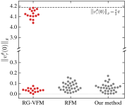
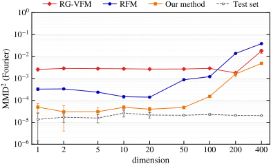
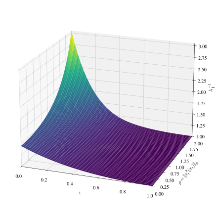
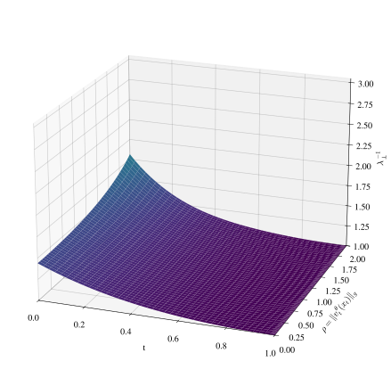

# [1]{.header-section-number} Introduction {#sec-introduction .unnumbered data-paper-number="1"}

Modern generative modelling owes much of its success to transport-based models, which learn to deform a simple base distribution into the target data distribution. Among them are diffusion models [@sohl-dickstein2015deep_unsupervised_learning; @ho2020ddpm] and normalizing flows [@tabak2013nonparametric_density_estimation; @rezende2015normalizing_flows; @papamakarios2021normalizing_flows]. In particular, conditional flow matching models [@lipman2023flow; @albergo2023building; @liu2023flow] are effective at generating images [@hu2024latent_space_editing], video [@jin2025pyramidal], and heterogeneous tabular data [@guzman-cordero2025exponential]. As flow matching models learn the transport map in terms of a time-dependent vector field, they belong to the class of continuous normalizing flows [@chen2018cnf]. To overcome the scalability challenges afflicting other models in this class, flow matching decomposes the intractable marginal probability path into simpler conditional paths that couple the base and data distributions. The idea is to learn the marginal velocity field by regression onto many examples of the simple fields generating these simple paths.

Many datasets are inherently non-Euclidean and more naturally modelled as distributions on curved manifolds of nontrivial topology. The dominant generalization of flow matching to manifolds is the Riemannian flow matching (RFM) model of @chen2024rfm. Recently, @eijkelboom2024variational have observed that the Euclidean flow matching objective is equivalent to maximizing the likelihood of a Gaussian model $q^\theta_t(x_1\mid x_t)$ of the true endpoint posterior $p_t(x_1\mid x_t)$. Cast in this light, flow matching generalizes to data supported on arbitrary, non-Euclidean spaces through an appropriate choice of parametric family $q^\theta_t$. Applying this to Riemannian manifolds, @zaghen2026rgvfm propose Riemannian Gaussian variational flow matching (RG-VFM), which maximizes the likelihood of @pennec2006's Riemannian Gaussian distribution over conditional endpoints.

By delineating two properties, we characterize loss functions for flow matching in terms of their likelihood model, whether that is explicit (as in RG-VFM) or implicit (as in RFM). First, we say a loss function is *compatible* if its population optimum is at the true marginal flow induced by the data and coupling. This is a minimal correctness check for an objective to be of general utility. Second, we say it is *support-aware* if the likelihood model puts mass only on velocities that are achievable. As depicted in @tbl-method-comparison, these are independent properties in the sense that RFM is compatible but not support-aware on compact manifolds, while RG-VFM is support-aware but not compatible.

Our theoretical contributions are:

- We derive a general compatibility condition for likelihood-based losses, satisfied by RFM but not RG-VFM. We show this analytically on the simplest non-Euclidean manifold, the flat torus $\mathbb{T}^1$. This general condition is of particular relevance to the manifold setting, but applies to *any* flow matching problem in which the conditional paths are nonlinear.

- We show that the squared error in the local flow scales with the product of distributional fit and a residual term. For a compatible model, the residual is zero, which eliminates this source of error even when the likelihood model is misspecified.

- We view RFM as maximizing likelihood over velocities in the tangent space under a Gaussian model of fixed covariance. This reveals how, despite being compatible, it omits global structure from its training signal. One example is compact manifolds, where the maximum flow speed is limited. Here, the RFM likelihood puts density on infeasible velocities.

This motivates our proposed method, which is both compatible and support-aware. We use an exponential family in endpoint space with the conditional velocity as sufficient statistic. This enforces compatibility regardless of the underlying geometry, inducing a geometrically preconditioned regression loss (with the RFM pipeline otherwise unchanged). Experimentally, we first compare methods on a simple distribution on $\mathbb{T}^1$ where the ideal behaviour of all models is analytic. Faced with rapid spatiotemporal variation in incompatible models, where gradients are uncontrolled except by the network Lipschitz constant, ODE solvers struggle. We then evaluate on high-dimensional tori and four geospatial datasets, following @chen2024rfm and @bortoli2022riemannian, as well as on a dataset of human poses in ${\mathrm{SO}(3)}^{19}$ with nearly 12 million training samples.

| Method | Network output | Compatible? | Support-aware on compact manifolds? |
| :--- | :--- | :--- | :---: |
| RFM | velocity | Yes | No |
| RG-VFM | endpoint | No | Yes |
| Ours | velocity | Yes | Yes |

: Comparison of our method against prior work. {#tbl-method-comparison}

# [2]{.header-section-number} Preliminaries {#sec-cfm-manifolds .unnumbered data-paper-number="2"}

## Riemannian flow matching (RFM) {.unnumbered}

@chen2024rfm apply flow matching to general manifolds, as long as we have a suitable notion of distance to hand. If we have the exponential and logarithmic maps, a natural way to construct conditional velocity fields is to follow the minimum-length geodesic at constant speed from a base sample $x_0\sim p_0$ at $t=0$ to a data sample $x_1\sim p_1$ at $t=1$. Then ${u_t^{\text{cond}}}(x_t\mid x_1)=\frac{1}{1-t}\log_{x_t}(x_1)$, where $x_t$ is the intermediate point[^1] along the geodesic at time $t$. Together with the coupling, these conditional velocity fields ${u_t^{\text{cond}}}(x_t\mid x_1)$ uniquely determine conditional probability paths $p_t(x_t\mid x_1)$ via the continuity equation, $$\partial_t p_t(\cdot\mid x_1)
+\operatorname{div}_g\left(
p_t(\cdot\mid x_1){u_t^{\text{cond}}}(\cdot\mid x_1)
\right)=0,$$ under the boundary conditions ${\operatorname{\mathbb{E}}}_{x_1}[p_t(x_t\mid x_1, t=0)]=p_{0}$ and ${\operatorname{\mathbb{E}}}_{x_1}[p_t(x_t\mid x_1, t=1)]=p_1$. The converse holds modulo gauge freedom in the velocity fields, as different velocity fields can induce the same probability path. Learning the marginal velocity field produces a transport map from the base distribution into the data distribution. To achieve this, the RFM loss is $${\operatorname{\mathcal{L}}_\mathrm{RFM}}(\theta)={\operatorname{\mathbb{E}}}_{t,x_0,x_1}\lVert {v_t^\theta}(x_t)-{u_t^{\text{cond}}}(x_t\mid x_1)\rVert^2_g.$$

## Variational flow matching (VFM) {.unnumbered}

In the Euclidean setting, @eijkelboom2024variational reformulate flow matching as likelihood maximization for a virtual parametric model $q_t^\theta(x_1\mid x_t)$ of the endpoint posterior $p_t(x_1\mid x_t)$. The objective is to minimize the KL divergence or, equivalently, to maximize a likelihood in endpoint space, $$\mathcal{L}_{\text{VFM}}(\theta)={\operatorname{\mathbb{E}}}_{t,x_t}\left[\operatorname{KL}(p_t(x_1\mid x_t)\|q_t^\theta(x_1\mid x_t))\right]
=-{\operatorname{\mathbb{E}}}_{t,x_0,x_1}[\log q_t^\theta(x_1\mid x_t)]+\text{const}.$$ This gives a unified framework in which, by choosing an appropriate likelihood model $q_t^\theta(x_1\mid x_t)$, flow matching generalizes to arbitrary data supports like the space of graphs. @eijkelboom2024variational show further that the squared norm loss of Euclidean flow matching corresponds to implicitly modelling the endpoint posterior as a Gaussian of fixed covariance.

## Riemannian Gaussian variational flow matching (RG-VFM) {.unnumbered}

@zaghen2026rgvfm extend this endpoint-likelihood view to manifolds. They choose the family of virtual models to be the Riemannian Gaussians of @pennec2006 with mean parameter $\mu_t^\theta$ and constant variance $\sigma^2=1$, $$q_t^\theta(x_1\mid x_t)\propto\exp\left(-\frac{1}{2\sigma^2}{\operatorname{dist}}_g (x_1, \mu_t^\theta(x_t))^2\right).$$ By restricting to homogeneous manifolds, where all points are geometrically equivalent under the symmetries of the manifold, @zaghen2026rgvfm propose the RG-VFM loss, $${\operatorname{\mathcal{L}}_\text{RG-VFM}}(\theta)={\operatorname{\mathbb{E}}}_{t,x_0,x_1}\left[{{\operatorname{dist}}}_g (x_1, \mu_t^\theta(x_t))^2\right].$$ This exploits the fact that the partition function of the Riemannian Gaussian on a homogeneous manifold is independent of $\mu_t^\theta(x_t)$. Hence, it can be dropped from the loss without affecting the optimization. Because $\mu_t^{\theta}$ is an endpoint, RG-VFM predicts the velocity as ${v_t^\theta}(x_t)=\frac{1}{1-t}\log_{x_t}(\mu_t^\theta(x_t))$.

# [3]{.header-section-number} Compatibility of training objectives {#sec-compatibility .unnumbered data-paper-number="3"}

We call a training objective *compatible* if every population minimizer, after applying the prescribed decoder from network output to velocity, produces the true marginal velocity,

$$
u_t(x_t) = {\operatorname{\mathbb{E}}}_{p_t(x_1\mid x_t)}\left[{u_t^{\text{cond}}}(x_t\mid x_1)\right].
$$ {#eq-compat-target}

This is the minimal requirement for correctness as it guarantees that transport along integral curves of $u_t(x_t)$ transforms the base distribution $p_0$ into the data $p_1$. Statistical decision theory would see this as an application of *Fisher consistency*; we use an alternative name here to avoid confusion with Consistency Models [@song2023consistency; @cheng2025riemannian]. Since $\arg\min_v {\operatorname{\mathbb{E}}}\lVert v - U\rVert_g^2 = {\operatorname{\mathbb{E}}}[U]$, RFM satisfies this. By contrast, the RG-VFM objective has global minima at any and all Fréchet means of $p_t(x_1\mid x_t)$. Converting such an endpoint on the manifold into a velocity tangent vector generally does not produce the true $u_t(x_t)$, except in Euclidean space.

The likelihood perspective of @eijkelboom2024variational is gaining traction, proliferating to a diversity of settings. As well as @zaghen2026rgvfm, the VFM lineage now includes the work of @guzman-cordero2025exponential, @matisan2026purrception, and @carrascopollo2026pawsterior. Alongside RG-VFM, future work is at risk of designing new losses for flow matching which *seem* natural, without checking for compatibility. Without an explicit check, we risk building on incompatible models. Possible mechanisms are that (1) the parametrization makes this analytically non-obvious, or (2) the added level of indirection obscures the connection to the careful construction of conditional flow matching.

In this section, we seek a general framework for compatibility of flow matching losses, both those that exist and those that *will* exist. Under the likelihood lens, we study the behaviour of these losses in the manifold setting. As our primary interest is the performance of such a likelihood model at best fit, we proceed under the idealized assumption of infinite data and network capacity. This allows us to reason beyond a binary condition of [yes]{.smallcaps} or [no]{.smallcaps} and quantify how far from the true marginal flow a likelihood model predicts in the worst case, even under optimal training.

## [3.1]{.header-section-number} A motivating example: incompatibility on a manifold without curvature {#sec-motivating-example .unnumbered data-paper-number="3.1"}

{#fig-t1-example-rgvfm fig-alt="Conditional paths on the one-dimensional torus meet where the true marginal velocity is zero; orange arrows show the two possible optimal RG-VFM predictions."}

@zaghen2026rgvfm [§4.2] write that RG-VFM implicitly captures the full geometric structure of the manifold while RFM lacks curvature information, resulting in weaker, less precise supervision. Therefore, we begin by comparing both methods on the flat torus $\mathbb{T}^1\cong\mathbb{R}/2\pi\mathbb{Z}$ where the geometric structure is both conceptually simple and without curvature. Consider the base and data distributions

$$
\begin{aligned}
  p_0 &= \tfrac{1}{2}\delta_{-\alpha} + \tfrac{1}{2}\delta_{+\alpha}, \\
  p_1 &= \tfrac{1}{2}\delta_{-\beta} + \tfrac{1}{2}\delta_{+\beta}
\end{aligned}
$$

under independent coupling $p_0\otimes p_1$. With some $\tau\in(0,\frac12)$, let $\beta \in (\frac{\pi}{2}, \pi(1-\tau))$ and $\alpha = \frac{\tau\beta}{1-\tau}$. As illustrated in @fig-t1-example-rgvfm, the two cross-pair geodesics then meet at $x=0$ at time $t=\tau$, carrying equal and opposite velocities. At $(x,t)=(0,\tau)$, their conditional expectation (the true marginal velocity) is zero. At the same $(x,t)=(0,\tau)$, RG-VFM minimizes the Fréchet function,

$$
\mathcal{L}[\mu^\theta_\tau(0)]=\frac12{\operatorname{dist}}_g (-\beta, \mu^\theta_\tau(0))^2+\frac12{\operatorname{dist}}_g (\beta, \mu^\theta_\tau(0))^2.
$$

This has local minima at $\mu^\theta_\tau(0)=0$ and $\mu^\theta_\tau(0)=\pi$; the loss is locally quadratic around each. Because $\beta>\pi/2$, the shorter arc between $x_1=-\beta$ and $x_1=\beta$ is the one through $\pi$. Under the RG-VFM loss, the unique and globally optimal endpoint prediction is $\mu^\theta_\tau(0)=\pi$. Decoding this endpoint prediction into a velocity prediction at $(0,\tau)$ gives a velocity of magnitude $\frac{\pi}{1-\tau}$. This is substantially different to the zero velocity we expect. Hence, despite the endpoint prediction being globally optimal under the loss, we have incompatible flow on a flat manifold.

Although this construction is intuitive and analytically tractable, a natural question is whether this behaviour is a consequence of the singular distributions and not the objective itself; we analyse a smoothed version in [Appendix A](#sec-proofs){.paper-section-ref}. Next, we formalize compatibility for all flow matching objectives viewed as likelihood maximization, agnostic of the base, coupling, or data.

## [3.2]{.header-section-number} The condition for compatibility of likelihood-based objectives {#sec-compatibility-condition .unnumbered data-paper-number="3.2"}

Think of training as fitting a model distribution $q^\theta(z)=q^\theta_t (z\mid x)$ at each $(x, t)$ to a data posterior $p(z)=p_t(z\mid x)$, where $z$ is whichever variable carries the likelihood, for example an endpoint $x_1$, a conditional velocity ${u_t^{\text{cond}}}$, or something else.[^2] The marginal velocity field is the expectation under $p$ of a feature $\psi_{x,t}(z)$ mapping $z$ to the space of conditional velocities, $u_t(x) = {\operatorname{\mathbb{E}}}_p[\psi_{x,t}(z)]$. For a model in endpoint space (like RG-VFM), $\psi_{x,t}(z) = {u_t^{\text{cond}}}(x\mid z)$, while for a model in velocity space (like RFM), $\psi_{x,t}(z) = z$. The question is whether likelihood optimization can distinguish between data posteriors that differ in $u_t(x)$.

Suppose $\theta=\theta^{*}$ is optimal for $p$ under the loss $\mathcal{L}_{p}(\theta)={\operatorname{\mathbb{E}}}_p[-\log q^{\theta}(z)]$. We wish to know if this optimum could give an incorrect velocity prediction. Consider an alternative $p'=p + h\ge 0$ for some (signed, square-integrable, mean-zero) $h$. Then

$$
\nabla_\theta\mathcal{L}_{p+h}(\theta^*)=\nabla_\theta\mathcal{L}_p(\theta^*)+\left[\nabla_{\theta}\int-\log q^{\theta}(z)h(z){\,\mathrm{d}z}\right]_{\theta=\theta^*}=-\int s^*(z)h(z){\,\mathrm{d}z},
$$ {#eq-perturbed-grad}

where $s^*(z) = \nabla_\theta \log q^\theta(z)|_{\theta=\theta^*}$ is the model score at optimum. This perturbation $h$ is invisible to the likelihood at first order if this integral vanishes. Meanwhile, it shifts the marginal velocity by

$$
{\operatorname{\mathbb{E}}}_{p+h}[\psi_{x,t}(z)] - {\operatorname{\mathbb{E}}}_p[\psi_{x,t}(z)] = \int \psi_{x,t}(z)\,h(z)\,\mathrm{d}z.
$$ {#eq-field-shift-perturb}

For a correct prediction, we need both @eq-perturbed-grad and @eq-field-shift-perturb to agree that a perturbation actually occurs. That is, the following logical implication must hold for all $h$:

$$
\int s^*(z)\,h(z)\,\mathrm{d}z = 0
  \quad\Longrightarrow\quad
  \int \psi_{x,t}(z)\,h(z)\,\mathrm{d}z = 0.
$$

Equivalently, this is a check for the existence of a $z$-independent linear map $A_{x,t}^\theta\colon\mathbb{R}^{m}\to T_x\mathcal{M}$ and vector $b_{x,t}^\theta\in T_x\mathcal{M}$ such that we have (almost everywhere),

$$
\psi_{x,t}(z)=A_{x,t}^\theta s^\theta(z)+b_{x,t}^\theta,\qquad\theta=\theta^*.
$$ {#eq-affine-criterion}

Since $\theta^*$ is unknown before training, a practical objective must satisfy @eq-affine-criterion at every $\theta$ in the model class, not just at the optimum. For RG-VFM, whose network output is $\mu=\mu_t^\theta(x_t)$, the target feature is $\psi_{x,t}(z)=\frac{1}{1-t}\log_x(z)$, and the score with respect to the network output is $s(z)=\frac{1}{\sigma^2}\log_{\mu}(z)$. As there is no global affine relationship between $\log_{\mu}(z)$ and $\log_x(z)$ on non-Euclidean manifolds, RG-VFM does not satisfy compatibility, obstructed by both curvature and topology.

## [3.3]{.header-section-number} Measuring the flow error {#sec-flow-error .unnumbered data-paper-number="3.3"}

A natural way to quantify the departure from compatibility is via the best approximation at the likelihood optimum, so as to satisfy @eq-affine-criterion as much as possible. Specifically, we solve the least-squares problem

$$
(A_{x,t}^*,\,b_{x,t}^*) \in \arg\min_{A,b}{\operatorname{\mathbb{E}}}_{q^{\theta^*}}\lVert\psi_{x,t}(z) - A s^*(z) - b\rVert_g^2,
$$ {#eq-affine-ls-fit}

denoting the residual term as $r_{x,t}(z) = \psi_{x,t}(z) - A_{x,t}^* s^*(z) - b_{x,t}^*$. We obtain the following bound, which is locally sharp in the sense of Cauchy--Schwarz:[^3]

::: {#thm-affine-residual-bound}

Assume measurable $\psi_{x,t}\in L^2(q^{\theta^*};T_x\mathcal M)$, $s^*\in L^2(q^{\theta^*};\mathbb R^m)$. Let $p$ be absolutely continuous with respect to $q^{\theta^*}$. Assume the first-order optimality condition ${\operatorname{\mathbb{E}}}_p[s^*(z)]=0$ (requiring $\theta^*$ to be interior) and enough regularity for the score identity ${\operatorname{\mathbb{E}}}_{q^{\theta^*}}[s^*(z)]=0$. Then

$$
\left\|{\operatorname{\mathbb{E}}}_p[\psi_{x,t}(z)]-{\operatorname{\mathbb{E}}}_{q^{\theta^*}}[\psi_{x,t}(z)]\right\|_g
\le\sqrt{\chi^2(p\|q^{\theta^*})}
\sqrt{\left\|{\operatorname{\mathbb{E}}}_{q^{\theta^*}}[r_{x,t}\otimes r_{x,t}]\right\|_{\mathrm{op},g}},
$$ {#eq-affine-residual-bound}

where $\chi^2(p\|q^{\theta^*})<\infty$ is the chi-squared divergence between $p$ and $q^{\theta^*}$.

:::

::: {.proof}

See [Appendix A.1](#sec-proof-affine-residual-bound){.paper-section-ref}.

:::

This elucidates why strong performance does not need the likelihood to be an accurate approximation to the density. A compatible likelihood model has zero residual $r_{x,t}$ and zero flow error at the population optimum, regardless of the residual distributional misfit $\chi^2(p\|q^{\theta^*})$. This gives a proof of the compatibility condition alternative to the exposition in [Section 3.2](#sec-compatibility-condition){.paper-section-ref}. Adding more degrees of freedom to the likelihood model, aiming for better density estimation, seems a natural way to reduce flow error. However, if the model is incompatible, the residual $r_{x,t}$ remains nonzero. Unconstrained by first-order conditions, a flow error generically persists. That is, we should favour likelihood families that possess compatibility over those that are more expressive but do not.

Moreover, the velocity implied by the likelihood model, ${\operatorname{\mathbb{E}}}_{q^{\theta^*}}[\psi_{x,t}(z)]$, is not necessarily the prediction the model uses in practice, ${v_t^\theta}(x_t)$. To avoid computing the expectation online, methods like RG-VFM use a decoder. This takes the parameters of the likelihood at the network head and maps them to a velocity prediction. Via the triangle inequality, this mismatch between the decoder and the likelihood moments leads to an additional error term:

$$
\begin{aligned}
\lVert v^{\theta}_{t}(x_{t})-u_{t}(x_{t})\rVert_{g}&=\lVert v^{\theta}_{t}(x_{t})-{\operatorname{\mathbb{E}}}_{q^{\theta^{\ast}}}[\psi_{x,t}]+{\operatorname{\mathbb{E}}}_{q^{\theta^{\ast}}}[\psi_{x,t}]-u_{t}(x_{t})\rVert_{g} \\
  &\le
\underbrace{\lVert {v_t^\theta}-{\operatorname{\mathbb{E}}}_{q^{\theta^*}}[\psi_{x,t}]\rVert_g}_{\text{likelihood-decoder mismatch}}
+\underbrace{\sqrt{\chi^2(p\|q^{\theta^*})}
\sqrt{\left\|{\operatorname{\mathbb{E}}}_{q^{\theta^*}}[r_{x,t}\otimes r_{x,t}]\right\|_{\mathrm{op},g}}}_{\text{likelihood misfit}\;\times\;\text{incompatibility bound}}.
\end{aligned}
$$

This reiterates that, in settings with nonlinear conditional paths, like on a manifold, a family of likelihoods needs more than geometric naturalness. In addition to compatibility, we would like to parametrize the likelihood family without this decoder error.

## [3.4]{.header-section-number} Riemannian flow matching does likelihood maximization implicitly {#sec-rfm-likelihood .unnumbered data-paper-number="3.4"}

Here, we express the RFM loss in maximum-likelihood form in velocity space as

$$
\mathcal{L}_{\mathrm{RFM}}(\theta)
= {\operatorname{\mathbb{E}}}_{t,x_0,x_1}\left[-\log q_t^\theta({u_t^{\text{cond}}}\mid x_t)\right] + \mathrm{const},
$$ {#eq-rfm-mle}

where $q_t^\theta({u_t^{\text{cond}}}\mid x_t)$ is the Gaussian $\mathcal{N}({u_t^{\text{cond}}};{v_t^\theta}(x_t),\frac12 g^{-1})$ over the full tangent space. The score with respect to the network output is $s(u)=2(u-{v_t^\theta})$, which is affine in the feature $\psi_{x,t}(u)=u$. Hence, RFM satisfies the compatibility condition. However, this Gaussian is not support-aware on compact manifolds. On a compact manifold $\mathcal{M}$, conditional velocities are bounded as

$$
\lVert{u_t^{\text{cond}}}(x_t\mid x_1)\rVert_g \leq \frac{\operatorname{diameter}(\mathcal{M})}{1-t}.
$$

The map $x_1 \mapsto {u_t^{\text{cond}}}(x_t\mid x_1)$ is not surjective. That is, many tangent vectors do not correspond to any endpoint on the manifold. Despite this, the Gaussian puts density on velocities outside the feasible set, regardless of the training distributions. Two adjacent velocities, straddling the boundary of the feasible set so that one is feasible and the other is not, have near equal loss. This discards prior knowledge of the global manifold structure and suggests an improvement to the method: using this information to improve training efficiency and optima achieved.

# [4]{.header-section-number} Method {#sec-method .unnumbered data-paper-number="4"}

These theoretical developments point to a likelihood family whose score is affine in the conditional velocity. In addition, we want to support the likelihood on manifold endpoints only, so as to avoid inefficient density assignment. As in @zaghen2026rgvfm, defining the likelihood in endpoint space (at least initially) is a natural way to achieve this. Keeping velocity prediction ${v_t^\theta}(x)\colon\mathcal M \to T_{x}\mathcal M$ as the network output, we propose an exponential family with conditional velocity as the sufficient statistic,

$$
q_t^{\theta}(x_1\mid x_t)
\propto c_{x,t}(x_1)\exp\!\left(\langle\eta,{u_t^{\text{cond}}}(x_t\mid x_1)\rangle_g\right).
$$ {#eq-endpoint-family}

This is an exponential family with natural parameter $\eta\in T_{x_t}\mathcal{M}$, carrier $c_{x,t}(x_1)\colon\mathcal M \to \mathbb{R}^+$. This uniquely maximizes entropy relative to $c_{x,t}\,\mathrm{dVol}_g(x_1)$ amongst endpoint distributions of a given mean velocity. Per the standard property of exponential families, let the mean map be

$$
m_{x,t}(\eta)=\nabla_\eta A_{x,t}(\eta)={\operatorname{\mathbb{E}}}_{q_t^\theta}[{u_t^{\text{cond}}}(x_t\mid x_1)],
$$

where $A_{x,t}(\eta)$ is the log-partition function,

$$
A_{x,t}(\eta)
=\log\int_{\mathcal M}c_{x,t}(x_1)\exp(\langle\eta,{u_t^{\text{cond}}}(x_t\mid x_1)\rangle_g)\,\mathrm{dVol}_g(x_1).
$$ {#eq-log-partition}

To tie the family to the network, we set $\eta=m_{x,t}^{-1}({v_t^\theta}(x_t))$. This makes the prediction of the model match the expectation of the likelihood. We discuss the domain of this in [Appendix C](#sec-method-details){.paper-section-ref}. The score with respect to $\eta$ is ${u_t^{\text{cond}}}(x_t\mid x_1)-{v_t^\theta}(x_t)$ and since the target feature is $\psi_{x,t}(x_1)={u_t^{\text{cond}}}(x_t\mid x_1)$, the compatibility condition of @eq-affine-criterion is satisfied. Hence, the model fulfils both key desiderata.

## Training loss {.unnumbered}

Differentiating the negative log-likelihood $\ell_{\mathrm{NLL}}(\theta)$ with respect to $\theta$ gives

$$
\nabla_\theta\ell_{\mathrm{NLL}}(\theta)
=(\nabla_\theta{v_t^\theta}(x_t))^\top V_{x,t}({v_t^\theta}(x_t))^{-1}({v_t^\theta}(x_t)-{u_t^{\text{cond}}}(x_t\mid x_1)),
$$ {#eq-method-grad}

where $V_{x,t}(v)=\nabla_\eta^2 A_{x,t}(\eta)\big|_{\eta=m_{x,t}^{-1}(v)}$ is the covariance of ${u_t^{\text{cond}}}$ at the natural parameter $\eta$ matching the predicted velocity $v$. This is the *Fisher information* of the model. Detaching $V_{x,t}$ from the backward pass yields a surrogate loss with gradients identical to those of the likelihood objective,[^4]

$$
\mathcal{L}(\theta)
=\frac{1}{2}{\operatorname{\mathbb{E}}}_{t,x_0,x_1}\left[
  \langle{v_t^\theta}(x_t)-{u_t^{\text{cond}}},\;{\operatorname{sg}}(V_{x,t}({v_t^\theta}(x_t)))^{-1}({v_t^\theta}(x_t)-{u_t^{\text{cond}}})\rangle_g
  \right],
$$ {#eq-method-surrogate}

where ${\operatorname{sg}}(\cdot)$ is the stop-gradient operator. Our method naturally reduces to a reweighting of the RFM objective, and crucially without opening up the entries of the preconditioning matrix as a new design space. In other settings, using the inverse Fisher information to adapt dynamics to the intrinsic geometry is an idea that has seen performance gains [@girolami2011rhmc].

## Choice of carrier {.unnumbered}

Although our construction addresses both key desiderata, the choice of carrier $c_{x,t}$ is apparently open. However, this design axis mostly collapses under several structural constraints. We seek a centred, isotropic carrier that factorizes on product manifolds, localizes around $x_t$ as $t\to1$, and recovers ordinary flow matching in Euclidean space. Among radial carriers, product factorization imposes a Gaussian form; terminal locality sets the decay; and matching the Euclidean covariance sets its scale ([Appendix A](#sec-proofs){.paper-section-ref}). This leads to the following choice, reminiscent of the Riemannian Gaussian in @zaghen2026rgvfm:

$$
c_{x,t}(x_1)
=\exp\left(-\frac12\frac{{\operatorname{dist}}_g(x_t,x_1)^2}{(1-t)^2}\right)
=\exp\left(-\frac12\lVert{u_t^{\text{cond}}}(x_t\mid x_1)\rVert_g^2\right).
$$

This is also normalizable on common noncompact manifolds, including hyperbolic space, which requires the carrier to have superlinear decay. As $t\to1$, the loss tends to that of RFM. In [Appendix B](#sec-supplementary-experiments){.paper-section-ref}, we study sensitivity to the carrier. The resulting velocity-space likelihood is Gaussian in Euclidean space and a truncated Gaussian on flat tori; on spheres, the loss upweights errors in speed relative to those in direction (@fig-s2-vinv-decomposition). This reflects the intuition that geodesic convergence on manifolds of positive curvature means errors in magnitude are more significant than those in direction.

## Practical computation {.unnumbered}

At first, it seems we must compute the mean map $m_{x,t}$ and covariance $V_{x,t}$ per training step, online and via numerical differentiation. The insight is that the more symmetries a manifold has, the fewer scalar functions $V_{x,t}$ depends on. By differentiating under the integral sign, we get a formula for each scalar function. On many manifolds, we pretabulate these via quadrature in low dimensions, often just one. Different datasets on a given manifold can reuse the same lookup table. On the flat torus $\mathbb T^d$, the covariance $V_{x,t}$ is diagonal with each entry an independent function of $\eta_i$. All factors share a single 1D lookup table. On spaces of constant curvature, isotropy cuts $V_{x,t}$ down to two scalar functions of the magnitude. On product manifolds, $V_{x,t}$ is block diagonal with one block per factor. This lets us compose tables and highlights that on many manifolds, the table dimension stays low as the manifold dimension grows. Queries to the lookup tables take $\mathcal{O}(1)$ time. In [Appendix F](#sec-perf){.paper-section-ref}, we show that, when compiled, the overhead per iteration is negligible.

# [5]{.header-section-number} Experiments {#sec-experiments .unnumbered data-paper-number="5"}

In this section, we evaluate our theoretical predictions and method across four settings. We defer implementation details to [Appendix C](#sec-method-details){.paper-section-ref} and evaluation and training protocols to [Appendix E](#sec-experiment-protocols){.paper-section-ref}.

{#fig-t1-probe-bimodality fig-alt="Velocity-error distributions for RFM, RG-VFM, and our method on the one-dimensional torus across 30 seeds."}

## Analytic test case {#sec-exp-t1-benchmark .unnumbered data-paper-number="5"}

We test the predictions of [Section 3.1](#sec-motivating-example){.paper-section-ref} under the parameters illustrated in @fig-t1-example-rgvfm with 30 seeds. @fig-t1-probe-bimodality shows the velocity error at $(x,t)=(0,\frac14)$. Both RFM and our method achieve velocities close to the ideal value of zero, while RG-VFM is bimodal and splits into two clusters of 15 seeds each. As the magnitude is bounded per [Section 3.4](#sec-rfm-likelihood){.paper-section-ref}, the upper cluster has its centre just below the value of $\frac{4\pi}{3}$ from [Section 3.1](#sec-motivating-example){.paper-section-ref}. The lower cluster corresponds to the population local minimum of RG-VFM at zero velocity, which is a stable attractor for some seeds but not globally optimal.

@tbl-t1-benchmark-distmetrics shows distributional metrics and, for dopri5, NFE and wall times. Ranking by $W_1$ agrees with ranking by velocity error at $(0,\frac14)$, supporting the idea that learning the marginal velocity is important for generative performance. RG-VFM seeds in the upper cluster are better by training loss than those in the lower cluster, but perform worse on generative metrics and require more ODE steps. Ranking by kernel methods favours our method and RFM over both RG-VFM clusters. A potential cause of this discrepancy is that optimal transport is more sensitive to the ratio of samples generated near to each Dirac and more affected by the $(0, \frac14)$ flow branch. RG-VFM has the highest inference NFEs and wall times by far. This is consistent with the rapid spatiotemporal variation we observe in the learned RG-VFM field in the absence of compatibility (see also @fig-t1-vecfield-slice-x0).

:::: {#tbl-t1-benchmark-distmetrics}

::: {.list-table header-rows=2 aligns="l,c,c,c,c,c,c,c"}

- - 
  - **Error** $\downarrow$
  - $\boldsymbol{W_1}\downarrow$
  - $\boldsymbol{W_2}\downarrow$
  - **Energy dist.** $\downarrow$
  - **MMD**$^{\mathbf{2}}$ $\downarrow$
  - **NFE** $\downarrow$
  - **Time** $\downarrow$

- - Method (# seeds)
  - $\Vert v^\theta_\tau(0)\Vert _g$
  - 
  - 
  - via $\sqrt{{\operatorname{dist}}_g}$
  - Laplace
  - dopri5
  - dopri5, (s)

- - RFM (30)
  - 0.070 $\pm$ 0.040
  - 0.45 $\pm$ 0.20
  - 0.88 $\pm$ 0.30
  - 0.214 $\pm$ 0.064
  - 0.055 $\pm$ 0.028
  - 497 \[426, 578\]
  - 1.92 \[1.65, 2.22\]

- - RG-VFM (30)
  - 2.080 $\pm$ 2.078
  - 0.54 $\pm$ 0.29
  - 0.83 $\pm$ 0.32
  - 0.311 $\pm$ 0.191
  - 0.085 $\pm$ 0.079
  - 36,839 \[33,796, 60,574\]
  - 141.4 \[130.3, 233.9\]

- - upper cluster (15)
  - 4.123 $\pm$ 0.042
  - 0.65 $\pm$ 0.30
  - 1.00 $\pm$ 0.31
  - 0.370 $\pm$ 0.212
  - 0.107 $\pm$ 0.089
  - 55,436 \[32,228, 70,115\]
  - 212.9 \[124.0, 271.9\]

- - lower cluster (15)
  - **0.037** $\pm$ 0.019
  - **0.42** $\pm$ 0.24
  - **0.66** $\pm$ 0.25
  - 0.251 $\pm$ 0.151
  - 0.063 $\pm$ 0.063
  - 36,638 \[35,411, 41,675\]
  - 140.4 \[136.8, 161.3\]

- - Our method (30)
  - 0.060 $\pm$ 0.041
  - 0.43 $\pm$ 0.18
  - 0.84 $\pm$ 0.31
  - **0.212** $\pm$ 0.055
  - **0.054** $\pm$ 0.024
  - **443** \[388, 582\]
  - **1.71** \[1.49, 2.24\]
:::

$\mathbb{T}^1$ analytic test case. Mean$\pm$std across seeds for distributional metrics. 20,000 samples per seed. Median $[Q_1, Q_3]$ for NFE and wall time of dopri5 with tolerance $10^{-5}$. RG-VFM seeds split by $\|v^\theta_\tau(0)\|_g$ into two clusters (see @fig-t1-probe-bimodality): 'lower' ($<0.1$) and 'upper' ($>4.0$).

::::

{#fig-torus-dim-sweep-fourier-mmd2 fig-alt="Fourier-kernel MMD squared for RFM, RG-VFM, and our method as the dimension of the flat torus increases."}

## High-dimensional product tori {.unnumbered}

Following the setup of @bortoli2022riemannian and @chen2024rfm, we evaluate on product tori $\mathbb{T}^d$ with uniform base and wrapped Gaussian data distribution of scale $\sigma=0.2$. This setup is of particular interest because the scale $0.2\ll 2\pi$ is so small that the optimal NLL of a continuous normalizing flow is analytic. Recall that ${\operatorname{\mathbb{E}}}_{p_1}[-\log p_1^\theta(x_1)]=\mathcal{H}[p_1]+\operatorname{KL}(p_1\parallel p_1^\theta)$ so the differential entropy of the true data gives a lower bound. As the density is isotropic, the per-dimension NLL lower bound is $\mathcal{H}[p_1]/d\approx\frac12\log(2\pi e\sigma^2)\approx-0.1905$, exact to 4 decimal places for all dimensions here. We see in @tbl-torus-dim-sweep-nll that NLL is uninformative for RG-VFM and several values reported by @chen2024rfm are below the entropic lower bound, which may be due to use of Rademacher vectors to estimate divergence. To mitigate this, we use exact divergence via `jacrev`. In [Appendix B](#sec-supplementary-experiments){.paper-section-ref}, we run the checkerboard experiment of @zaghen2026rgvfm, testing many solver settings to sanity-check that the NLL results of RG-VFM are not an artefact of our implementation.

In @fig-torus-dim-sweep-fourier-mmd2, the MMD$^2$ gives an interesting comparison. We see that before dimension 200, there is a consistent ordering of methods with our method best, RFM second, and RG-VFM last. Beyond this, our method maintains its advantage while RFM and RG-VFM swap places. This is consistent with the idea of [Section 3.4](#sec-rfm-likelihood){.paper-section-ref} that awareness of geometric constraints is important for scalability.

| $d$ | **Our method** | **RFM**   Paper results | **RFM**   Reproduced | **RG-VFM** | **Riemannian**   **Score-Based** |
| ---: | :---: | :---: | :---: | :---: | :---: |
| $1$ | **-0.1904** $\pm$ 0.001 | [-0.2051 $\pm$ 0.010 †]{.below-bound} | -0.1715 $\pm$ 0.006 | [-0.2171 $\pm$ 0.001 †]{.below-bound} | -0.1482 $\pm$ 0.010 |
| $2$ | **-0.1900** $\pm$ 0.005 | -0.1495 $\pm$ 0.010 | -0.1658 $\pm$ 0.004 | [-0.2142 $\pm$ 0.003 †]{.below-bound} | -0.1412 $\pm$ 0.010 |
| $5$ | **-0.1879** $\pm$ 0.004 | -0.1851 $\pm$ 0.010 | -0.1681 $\pm$ 0.003 | [-0.2157 $\pm$ 0.002 †]{.below-bound} | -0.1519 $\pm$ 0.010 |
| $10$ | -0.1827 $\pm$ 0.004 | **-0.1838** $\pm$ 0.010 | -0.1678 $\pm$ 0.002 | [-0.2211 $\pm$ 0.002 †]{.below-bound} | -0.1404 $\pm$ 0.010 |
| $20$ | **-0.1871** $\pm$ 0.001 | [-0.2105 $\pm$ 0.010 †]{.below-bound} | -0.1673 $\pm$ 0.001 | [-0.2935 $\pm$ 0.011 †]{.below-bound} | -0.1230 $\pm$ 0.010 |
| $50$ | **-0.1847** $\pm$ 0.001 | [-0.2111 $\pm$ 0.010 †]{.below-bound} | -0.1687 $\pm$ 0.001 | [-0.3524 $\pm$ 0.010 †]{.below-bound} | -0.0840 $\pm$ 0.010 |
| $100$ | **-0.1758** $\pm$ 0.003 | [-0.2065 $\pm$ 0.010 †]{.below-bound} | -0.1553 $\pm$ 0.001 | [-0.4091 $\pm$ 0.008 †]{.below-bound} | 0.0355 $\pm$ 0.010 |
| $200$ | -0.1643 $\pm$ 0.002 | **-0.1701** $\pm$ 0.010 | -0.0993 $\pm$ 0.001 | [-0.3368 $\pm$ 0.017 †]{.below-bound} | 0.0745 $\pm$ 0.010 |
| $400$ | -0.1374 $\pm$ 0.002 | **-0.1432** $\pm$ 0.010 | -0.0232 $\pm$ 0.002 | [-1.1979 $\pm$ 0.040 †]{.below-bound} | 0.1423 $\pm$ 0.010 |

: High-dimensional flat tori: NLL/dim$\downarrow$. Mean$\pm$std, 5 seeds for our method, RFM (Reproduced), and RG-VFM. 20,000 samples/seed. Target is a wrapped Gaussian $(\sigma=0.2)$. Values marked † are below the entropic bound. The best of the unmarked are in **bold**. RFM (Paper results) and Riemannian Score-Based [@bortoli2022riemannian] values are extracted from fig. 5 of @chen2024rfm using WebPlotDigitizer [@WebPlotDigitizer] with a uniform uncertainty estimate of 0.01. {#tbl-torus-dim-sweep-nll}

:::: {#tbl-climate-sphere-results-nll}

::: {.list-table header-rows=2 aligns="l,c,c,c,c"}

- - 
  - **Volcano**
  - **Earthquake**
  - **Flood**
  - **Fire**

- - Dataset size (train + val + test)
  - 827
  - 6,120
  - 4,875
  - 12,809

- - Riemannian CNF [@mathieu2020riemannian]
  - -0.97 $\pm$ 0.15
  - 0.19 $\pm$ 0.04
  - 0.90 $\pm$ 0.03
  - -0.66 $\pm$ 0.05

- - Moser Flow [@rozen2021moser]
  - -2.02 $\pm$ 0.42
  - -0.09 $\pm$ 0.02
  - 0.62 $\pm$ 0.04
  - -1.03 $\pm$ 0.03

- - CNF Matching [@ben-hamu2022cnf_matching]
  - -2.38 $\pm$ 0.17
  - -0.38 $\pm$ 0.01
  - **0.25** $\pm$ 0.02
  - -1.40 $\pm$ 0.02

- - Riemannian Score-Based [@bortoli2022riemannian]
  - -4.92 $\pm$ 0.25
  - -0.19 $\pm$ 0.07
  - 0.45 $\pm$ 0.17
  - -1.33 $\pm$ 0.06

- - Riemannian Diffusion Model [@huang2022riemannian]
  - -6.61 $\pm$ 0.97
  - **-0.40** $\pm$ 0.05
  - 0.43 $\pm$ 0.07
  - -1.38 $\pm$ 0.05

- - RFM (Paper results)
  - -7.93 $\pm$ 1.67
  - -0.28 $\pm$ 0.08
  - 0.42 $\pm$ 0.05
  - -1.86 $\pm$ 0.11

- - RFM (Reproduced)
  - -6.96 $\pm$ 1.71
  - -0.21 $\pm$ 0.05
  - 0.48 $\pm$ 0.04
  - -1.77 $\pm$ 0.06

- - Our method
  - **-9.69** $\pm$ 1.94
  - -0.28 $\pm$ 0.04
  - 0.47 $\pm$ 0.04
  - **-2.11** $\pm$ 0.11
:::

Earth and climate science datasets on the sphere: test NLL$\downarrow$. Mean$\pm$std, 5 seeds.

::::

## Earth and climate science datasets on the sphere {.unnumbered}

Following @chen2024rfm, we apply our method to datasets compiled from NGDC/WDS [-@noaa2020a_earthquakes; -@noaa2020b_volcanoes], @brakenridge2017floods, and @eosdis2020activefire by @mathieu2020riemannian. In @tbl-climate-sphere-results-nll, we see uniform improvement relative to our reproduction of the baseline. While our method, like RFM, struggles on the earthquake and flood datasets, it improves over prior work on the volcano and fire datasets, which are the smallest and largest datasets respectively and have highly concentrated regions requiring high fidelity [see plots in @bortoli2022riemannian]. The models outperforming our method and RFM (Reproduced) do not require implicitly specifying a particular transport path. This allows them to optimize the path. The trade-off is lack of scalability above low manifold dimension.

## High-dimensional human pose data {.unnumbered}

We further evaluate on a large-scale dataset of human poses from [amass]{.smallcaps} [@mahmood2019amass], embedded in ${\mathrm{SO}(3)}^{19}$, following @dunkel2024huproso3 in the partition of the dataset we use. We train RFM, RG-VFM, and our method on 11,823,971 samples from this partition. We also compare with the released checkpoint of HuProSO3 [@dunkel2024huproso3], which was trained on the full partition, including our test samples. We see in @tbl-pose-results that our method outperforms according to both sample-based metrics. This supports the use of our method, especially in high-dimensional applications where sample quality is of particular importance.

:::: {#tbl-pose-results}

::: {.list-table header-rows=2 aligns="l,c,c,c"}

- - 
  - **NLL** $\downarrow$
  - **Energy distance** $\downarrow$
  - **Gaussian MMD**$^{\mathbf{2}}$ $\downarrow$

- - Method
  - w.r.t. Haar
  - chordal, $\times 10^3$
  - chordal, $\times 10^3$

- - HuProSO3
  - -137.78
  - 56.76
  - 9.746

- - RG-VFM
  - -150.58 $\pm$ 0.41
  - 18.60 $\pm$ 1.72
  - 3.601 $\pm$ 0.308

- - RFM
  - **-198.11** $\pm$ 0.81
  - 2.16 $\pm$ 0.20
  - 0.379 $\pm$ 0.035

- - Our method
  - -197.41 $\pm$ 0.44
  - **1.68** $\pm$ 0.04
  - **0.293** $\pm$ 0.008
:::

Human pose on ${\mathrm{SO}(3)}^{19}$. Mean$\pm$std, 5 seeds, except HuProSO3, which uses the released checkpoint `id_0900`. 20,000 samples per seed.

::::

# [6]{.header-section-number} Limitations {#sec-limitations .unnumbered data-paper-number="6"}

Similar to RFM [@chen2024rfm] and RG-VFM [@zaghen2026rgvfm], our method requires specialization per manifold. Both RFM and RG-VFM have the advantage of only requiring well-studied manifold objects. Tables of metric tensors and logarithmic maps are readily available; our method brings the added work of devising an efficient way to compute and invert the mean map and pretabulate the covariance components. This generally involves identifying a symmetry that reduces the integration to low-dimensional quadrature, differentiating under the integral sign, and crafting a numerically stable implementation. We have not implemented our method on general geometries as extensively as @chen2024rfm have for RFM. For manifolds without closed-form geodesics, even RFM is costly and complex. In this setting, probability paths are defined via diffusive or biharmonic premetrics, so our method would need to perform quadrature over these or estimate the mean and variance via Monte Carlo, which may be prohibitive. We discuss these potential extensions in [Appendix C](#sec-method-details){.paper-section-ref}. As in RG-VFM, we target data with known symmetries and geometric structure rather than arbitrary 3D meshes, but it may be possible to extend our method to these settings. Unlike RG-VFM, we do not require homogeneity, although it is useful in practice.

# [7]{.header-section-number} Related Work {#sec-related-work .unnumbered data-paper-number="7"}

@guzman-cordero2025exponential previously suggested, based on the ideas of @eijkelboom2024variational, that likelihoods over endpoints should be exponential families with a parameter of interest as the sufficient statistic. Their work targets heterogeneous tabular data, relying on the identity $u_t(x_t)={\operatorname{\mathbb{E}}}[{u_t^{\text{cond}}}(x_t\mid x_1)]={u_t^{\text{cond}}}(x_t\mid{\operatorname{\mathbb{E}}}[x_1])$ via linearity of conditional paths to estimate the marginal field from the endpoint prediction, similar to RG-VFM. As this work establishes, the nonlinearity of conditional paths on manifolds means that such constructions do not generally possess compatibility.

Prior intrinsic generative models include Riemannian CNFs [@mathieu2020riemannian], Moser Flow [@rozen2021moser], CNF Matching [@ben-hamu2022cnf_matching], and score-based [@bortoli2022riemannian] and ELBO-based diffusion [@huang2022riemannian]. However, as @chen2024rfm discuss, these require simulated random walks [@huang2022riemannian; @bortoli2022riemannian], approximations to the heat kernel [@bortoli2022riemannian], heavy divergence computation [@huang2022riemannian] or Hutchinson estimation [@mathieu2020riemannian]. Earlier simulation-free methods [@rozen2021moser; @ben-hamu2022cnf_matching] scale poorly to high dimensions and general geometries.

With the exception of RG-VFM, recent manifold extensions of flow matching mostly specialize RFM to particular geometries or applications [as in @cheng2024categorical; @miller2024flowmm; @cheng2025stiefel], or propose an alternative method for a single manifold class [as in @collas2025riemannian]. An orthogonal line of work focuses on accelerated inference. Consistency models [@song2023consistency] distil one-step maps from intermediate states to data, and Riemannian consistency models [@cheng2025riemannian] port this idea to manifolds. Similarly, flow maps [@boffi2025flowmaps] use self-distillation for few-step inference, and @davis2026generalisedflowmaps propose Generalized Flow Maps for manifolds.

# [8]{.header-section-number} Conclusion {#sec-conclusion .unnumbered data-paper-number="8"}

At population optima, likelihood maximization generically fails to recover the true marginal velocity. Our compatibility condition characterizes when it succeeds. Our residual bound shows that compatibility is enough to avoid this source of error even if the likelihood is misspecified. On compact manifolds, prior work satisfying the condition assigns Gaussian likelihood to infeasible velocities. We propose an exponential family in endpoint space that preconditions the loss while being both compatible and support-aware. Empirically, our method recovers the expected velocity in the analytic test case, improves NLL on two spherical benchmarks, and improves sample-based metrics on high-dimensional tori and human poses. More broadly, in choosing a likelihood for flow matching, we must consider not only the intrinsic geometry, but also whether optimizing yields the right flow.

## Acknowledgements {.unnumbered}

This research is supported through the EPSRC ROSEHIPS grant \[EP/W005816/1\].

# Appendix {.unnumbered}

## Organization of the appendix {.unnumbered}

We prove and derive the main theoretical results of interest in [Appendix A](#sec-proofs){.paper-section-ref}; we share more experiments and ablations in [Appendix B](#sec-supplementary-experiments){.paper-section-ref}; we describe implementation details and training algorithms in [Appendix C](#sec-method-details){.paper-section-ref}; we specialize the method to some common manifolds of interest in [Appendix D](#sec-geometric-specializations){.paper-section-ref}; we outline the experimental protocols and hyperparameters in [Appendix E](#sec-experiment-protocols){.paper-section-ref}; and we report measurements of computational performance in [Appendix F](#sec-perf){.paper-section-ref}.

# [A]{.header-section-number} Proofs and theoretical derivations {#sec-proofs .unnumbered data-paper-number="A"}

## [A.1]{.header-section-number} Compatibility bound {#sec-proof-affine-residual-bound .unnumbered data-paper-number="A.1"}

See @thm-affine-residual-bound.

::: {.proof}

The residual $r_{x,t}$ is defined as that of the least-squares problem $$(A_{x,t}^*,b_{x,t}^*)
\in \arg\min_{A,b}
{\operatorname{\mathbb{E}}}_{q^{\theta^*}}\left[
\|\psi_{x,t}(z)-As^*(z)-b\|_g^2
\right].$$ In particular, $$\psi_{x,t}=A_{x,t}^*s^*+b_{x,t}^*+r_{x,t}.$$ Now taking expectations under each distribution $p$ and $q^{\theta^*}$, $$\begin{aligned}
{\operatorname{\mathbb{E}}}_p[\psi_{x,t}]
&=A_{x,t}^*\underbrace{{\operatorname{\mathbb{E}}}_p[s^*]}_{0}+b_{x,t}^*+{\operatorname{\mathbb{E}}}_p[r_{x,t}],\\
{\operatorname{\mathbb{E}}}_{q^{\theta^*}}[\psi_{x,t}]
&=A_{x,t}^*\underbrace{{\operatorname{\mathbb{E}}}_{q^{\theta^*}}[s^*]}_{0}+b_{x,t}^*
  +{\operatorname{\mathbb{E}}}_{q^{\theta^*}}[r_{x,t}].
\end{aligned}$$ In the subtraction of these expressions, the $b_{x,t}^*$ terms cancel and we are left with $$\begin{aligned}
{\operatorname{\mathbb{E}}}_p[\psi_{x,t}]
-{\operatorname{\mathbb{E}}}_{q^{\theta^*}}[\psi_{x,t}]
&={\operatorname{\mathbb{E}}}_p[r_{x,t}]
-{\operatorname{\mathbb{E}}}_{q^{\theta^*}}[r_{x,t}]\\
&={\operatorname{\mathbb{E}}}_{q^{\theta^*}}\left[
\left(\frac{\mathrm dp}{\mathrm d q^{\theta^*}}-1\right)
r_{x,t}
\right].
\end{aligned}$$

For any unit vector $w\in T_x\mathcal M$, Cauchy--Schwarz yields $$\begin{aligned}
\left|
\left\langle w,\,
{\operatorname{\mathbb{E}}}_p[\psi_{x,t}]
-{\operatorname{\mathbb{E}}}_{q^{\theta^*}}[\psi_{x,t}]
\right\rangle_g
\right|&\le
\sqrt{\chi^2(p\|q^{\theta^*})}
\sqrt{{\operatorname{\mathbb{E}}}_{q^{\theta^*}}[
    \langle w,r_{x,t}\rangle_g^2
]}\\
&=
\sqrt{\chi^2(p\|q^{\theta^*})}
\sqrt{
\left\langle w,\,
{\operatorname{\mathbb{E}}}_{q^{\theta^*}}[r_{x,t}\otimes r_{x,t}]w
\right\rangle_g
}\\
&\le
\sqrt{\chi^2(p\|q^{\theta^*})}
\sqrt{
\left\|{\operatorname{\mathbb{E}}}_{q^{\theta^*}}[
r_{x,t}\otimes r_{x,t}]
\right\|_{\mathrm{op},g}
}.
\end{aligned}$$ Taking supremum over unit vectors $w$ concludes the proof.

:::

## [A.2]{.header-section-number} Motivating example with smooth data on $\mathbb T^1$ {#sec-example-smoothed .unnumbered data-paper-number="A.2"}

Here, we check whether the example of [Section 3.1](#sec-motivating-example){.paper-section-ref} survives after smoothing the mixture of Diracs into that of wrapped Gaussians,

$$
\begin{aligned}
p_0 &= \frac12\mathcal{WN}(-\alpha,\sigma_0^2)
     + \frac12\mathcal{WN}(+\alpha,\sigma_0^2),\\
p_1 &= \frac12\mathcal{WN}(-\beta,\sigma_1^2)
     + \frac12\mathcal{WN}(+\beta,\sigma_1^2).
\end{aligned}
$$

As before, let $\tau\in(0,\tfrac12)$, $\beta\in(\tfrac\pi2,\pi(1-\tau))$, and $\alpha=\frac{\tau\beta}{1-\tau}$. Geodesics joining the component centres $(+\alpha,-\beta)$ and $(-\alpha,+\beta)$ meet at $x_\tau=0$. For a coupled pair with geodesic velocity $w=\log_{x_0}(x_1)\in[-\pi,\pi]$ at $x_t=x$, the endpoints satisfy $x_0=x-tw$ and $x_1=x+(1-t)w$ (modulo $2\pi$). As the change of variables has unit Jacobian, under independent coupling the conditional density satisfies

$$
p_t(w\mid x)\propto
p_0(x-tw)p_1(x+(1-t)w).
$$

Both mixtures satisfy $p_i(x)=p_i(-x)$. Hence, $p_t(w\mid0)=p_t(-w\mid0)$. For all $\sigma_0,\sigma_1>0$ and $0\le t<1$,

$$
u_t(0)=\int_{-\pi}^{\pi}w\,p_t(w\mid0)\,\mathrm dw=0.
$$

### Local behaviour of the marginal velocity {.unnumbered}

The derivative $u_\tau'(0)$ determines the direction of the true marginal field near the crossing. Let $\tau=\tfrac14$, $\alpha=\tfrac13\beta$, and $\sigma_0=\sigma_1=\sigma$. For small $\sigma$, the two crossing component pairs dominate $p_{\frac14}(w\mid x)$ near $x=0$. Via the corresponding Gaussian components on $\mathbb R$, we calculate the conditional mean of $w$ for each crossing pair. For pairs centred at $(+\alpha,-\beta)$ and $(-\alpha,+\beta)$, we have, via completion of the square,

$$
\begin{aligned}
\mathcal N\left(x-\frac14w;\,\pm\alpha,\sigma^2\right)
\mathcal N\left(x+\frac34w;\,\mp\beta,\sigma^2\right)
&\propto \exp\left(
-\frac{(x-\tfrac14w\mp\alpha)^2+(x+\tfrac34w\pm\beta)^2}{2\sigma^2}
\right)\\
&=
\exp\left(
-\frac{5}{16\sigma^2}
\left(w+\frac{4x}{5}\pm(\alpha+\beta)\right)^2
-\frac{4x^2}{5\sigma^2}
\right).
\end{aligned}
$$

The two Gaussian products have the same dependence on $x$ (after integration over $w\in\mathbb R$), so they also have equal posterior weights. Averaging over the two crossing pairs cancels the terms in $\alpha+\beta$,

$$
\begin{aligned}
{\operatorname{\mathbb{E}}}\left[w\mid x_{\frac14}=x,\text{ crossing pairs}\right]
&=\frac12\left(-(\alpha+\beta)-\frac45x
                  +(\alpha+\beta)-\frac45x\right)\\
&=-\frac45x.
\end{aligned}
$$

For pairs whose endpoints are of the same sign, the mean of $x_{\frac14}$ is $\pm\tfrac12\beta$; for crossing pairs, it is zero. For all four cases, the variance is $\tfrac58\sigma^2$. For each pair whose endpoints are of the same sign, the distribution of $x_{\frac14}$ has density at zero equal to $e^{-\beta^2/(5\sigma^2)}$ times that for a crossing pair. To obtain the derivative for the wrapped distributions, we must also account for periodic copies and the restriction $|w|\le\pi$. We have

$$
u_t(x)
=\frac{\int_{-\pi}^{\pi}w\,p_0(x-tw)p_1(x+(1-t)w)\,\mathrm dw}
{\int_{-\pi}^{\pi}p_0(x-tw)p_1(x+(1-t)w)\,\mathrm dw}.
$$

Since $u_t(0)=0$, differentiating gives

$$
\begin{aligned}
u_t'(0)
&=\frac{\int_{-\pi}^{\pi}w\left[p_0'(-tw)p_1((1-t)w)
+p_0(-tw)p_1'((1-t)w)\right]\,\mathrm dw}
{\int_{-\pi}^{\pi}p_0(-tw)p_1((1-t)w)\,\mathrm dw}\\
&=
{\operatorname{\mathbb{E}}}_{p_t(\cdot\mid0)}
\left[
w\left(
\frac{p_0'(-tw)}{p_0(-tw)}
+\frac{p_1'((1-t)w)}{p_1((1-t)w)}
\right)
\right].
\end{aligned}
$$

At $x_{\frac14}=0$, the endpoints satisfy $x_0=-\frac14w$ and $x_1=\frac34w$. Both endpoints coincide with their Gaussian means for only the crossing pairs, at $w=\pm\tfrac43\beta\in(-\pi,\pi)$. For the other pairs, no value of $w$ puts both endpoints at their Gaussian means. The crossing peaks lie some fixed distance from the integration boundaries. Hence, other Gaussian terms and the tails, added when extending the crossing integrals to $\mathbb R$, change the derivative of the numerator and the value of the denominator by at most $C\sigma^{-K}e^{-c/\sigma^2}$ for some $C,c>0$ and finite $K$. The crossing terms contribute a denominator of order $\sigma^{-1}$, so

$$
u'_{\frac14}(0)=-\frac45+\mathcal O(e^{-c'/\sigma^2})
$$

for some $c'>0$. Reflection means $u_{\frac14}(x)$ is odd, implying that

$$
u_{\frac14}(x)=
\left(-\frac45+\mathcal O(e^{-c'/\sigma^2})\right)x
+\mathcal O_\sigma(x^3).
$$

That is to say, for sufficiently narrow components, the true marginal velocity points toward zero on both sides of the crossing.

### Global optimum of the RG-VFM loss for smooth data {.unnumbered}

RG-VFM minimizes the Fréchet function of the conditional endpoint distribution. At $x_\tau=0$, the endpoint corresponding to $w$ is $x_1=(1-\tau)w$, so

$$
F(\mu)=\int_{-\pi}^{\pi}
{\operatorname{dist}}_g((1-\tau)w,\mu)^2p_\tau(w\mid0)\,\mathrm dw.
$$

By symmetry, $F(\pi+\delta)=F(\pi-\delta)$, meaning $\mu=\pi$ is always a stationary point. Let $Y=(1-\tau)|w|$ be the magnitude of the endpoint, where $p_\tau(w\mid0)$ induces the density $\rho$ of $Y$. Again by symmetry, it will suffice to compare $\pi$ with $\mu=\pi-\delta$ for $0\le\delta\le\pi$. For symmetric endpoints $\pm y$, the Fréchet function changes by

$$
\begin{aligned}
\frac12
{\operatorname{dist}}_g(\pi-\delta,y)^2+
\frac12{\operatorname{dist}}_g(\pi-\delta,-y)^2
-(\pi-y)^2
&=\begin{cases}
\delta^2,&\delta\le y,\\
\delta^2-2\pi(\delta-y),&\delta>y
\end{cases}\\
&=\delta^2-2\pi[\delta-y]_+.
\end{aligned}
$$

Now, averaging over $Y,$

$$
F(\pi-\delta)-F(\pi)
=\delta^2-2\pi\int_0^\delta
(\delta-y)\rho(y)\,\mathrm dy.
$$

Only endpoint magnitudes $Y<\delta$ contribute to the second term, which offsets the quadratic cost of moving away from $\pi$. Choose $b\in(\pi/2,\beta)$ and let $M=\sup_{0\le y\le b}\rho(y)$. If $M<1/\pi$ and $b\operatorname{\mathbb{P}}(Y\ge b)>\pi/2$, then, for $0<\delta\le b$,

$$
\begin{aligned}
F(\pi-\delta)-F(\pi)
&\ge\delta^2-2\pi M\int_0^\delta(\delta-y)\,\mathrm dy\\
&=\underbrace{(1-\pi M)}_{>0}\delta^2.
\end{aligned}
$$

For $b\le\delta\le\pi$,

$$
\begin{aligned}
F(\pi-\delta)-F(\pi)
&=\delta^2-2\pi{\operatorname{\mathbb{E}}}\left[[\delta-Y]_+\right]\\
&=\delta^2-2\pi\delta+2\pi{\operatorname{\mathbb{E}}}[\min(\delta,Y)]\\
&\ge(\pi-\delta)^2
+\underbrace{2\pi b\operatorname{\mathbb{P}}(Y\ge b)-\pi^2}_{>0}.
\end{aligned}
$$

For the wrapped Gaussian mixtures, $Y$ concentrates at $\beta$ as $\sigma_0,\sigma_1\to0$, so $M\to0$ and $\operatorname{\mathbb{P}}(Y\ge b)\to1$. The strict inequalities hold for sufficiently small component variances, persisting for small perturbations (within the family of symmetric mixtures). Hence $\mu=\pi$ is the unique global optimum for RG-VFM on an open region within the parameterized family of symmetric smooth mixtures. At $\mu=\pi$, either minimum-length geodesic from zero has length $\pi$. Because of this, the smoothed case has the same branch ambiguity as for the mixture of Diracs. While symmetry gives $u_\tau(0)=0$, RG-VFM decodes this endpoint into a velocity of magnitude $\frac{\pi}{1-\tau}$. Again, the velocity error at the population optimum is

$$
\left\|v_\tau^{\theta^*}(0)-u_\tau(0)\right\|_g
=\frac{\pi}{1-\tau}.
$$

## [A.3]{.header-section-number} Characterization of the Gaussian carrier {#sec-carrier-choice .unnumbered data-paper-number="A.3"}

As the theory of compatibility does not select a universal carrier, we impose a small number of heuristic desiderata. We desire for the carrier to be centred, isotropic, factorizable on product manifolds, give ordinary CFM in the Euclidean case, linearize to RFM in the limit $t\to1$, and be normalizable on manifolds of interest. For a radially isotropic carrier, coordinates on product manifolds enter only through the joint norm $\lVert{u_t^{\text{cond}}}\rVert_g$. Following the same derivation as for Herschel--Maxwell, we write such a carrier as $f(\lVert u\rVert_g^2)$ and use factorization to obtain

$$
\frac{f(a+b)}{f(0)}=\frac{f(a)}{f(0)}\frac{f(b)}{f(0)},
$$

where $a,b\geq0$. Hence, by continuity, $f(a)=f(0)e^{-\beta a}$. Geodesic exponentials provide a natural setting in which to vary the tailedness of the carrier in ablation (see [Appendix B.3](#sec-carrier-ablation){.paper-section-ref}). Terminal locality excludes the constant and growing choices. This means that $\beta>0$, and equating the Euclidean covariance to $I$ selects $\beta=\tfrac12$ uniquely. The requirements narrow to the present choice of Gaussian carrier.

## [A.4]{.header-section-number} Limiting behaviour and relationship to Riemannian flow matching {#sec-rfm-special-case .unnumbered data-paper-number="A.4"}

### Manifolds with diffeomorphic exponential map {.unnumbered}

On these *non*compact manifolds, a special choice of carrier recovers Riemannian flow matching. We see that the Jacobian term introduces an artificial linearization of the likelihood model over endpoints, collapsing the variance to the identity. Let the carrier be

$$
c_{x,t}(x_1)=\exp\left(-\frac12\lVert{u_t^{\text{cond}}}\rVert_g^2\right)
\left|\det D{u_t^{\text{cond}}}\right|.
$$

Here, $\left|\det D{u_t^{\text{cond}}}\right|$ is the Jacobian determinant with respect to the Riemannian volume measures. The exponential family over endpoints

$$
q_{t}(\mathrm{d}x_1 | x_t; \eta)=c_{x,t}(x_1)\exp\left(\langle\eta,{u_t^{\text{cond}}}\rangle_g-A_{x,t}(\eta)\right)\,
\mathrm{dVol}_g(x_1)
$$

pushes forward under ${u_t^{\text{cond}}}$ to a density on $T_x\mathcal M$,

$$
\begin{aligned}
q_u(u;\eta)
&\propto\exp\left(-\frac12\lVert u\rVert_g^2+\langle\eta,u\rangle_g\right)
\overbrace{\left|\det D{u_t^{\text{cond}}}\right|}^{\text{carrier}}
\underbrace{\left|\det D{u_t^{\text{cond}}}\right|^{-1}}_{\text{change of variables}}\\
&=\exp\left(-\frac12\lVert u-\eta\rVert_g^2+\frac12\lVert\eta\rVert_g^2\right).
\end{aligned}
$$

Thus the pushforward is $\mathcal N(\eta,g^{-1})$, and

$$
\begin{aligned}
A_{x,t}(\eta)
&=\log\int_{T_x\mathcal M}
\exp\left(-\frac12\lVert u\rVert_g^2+\langle\eta,u\rangle_g\right)\,\mathrm{dVol}_g(u)\\
&=\frac12\lVert\eta\rVert_g^2+\frac d2\log(2\pi).
\end{aligned}
$$

In consequence, $m_{x,t}(\eta)=\eta$, $V_{x,t}=I$, and the likelihood-based loss is equivalent to RFM up to the factor $\frac12$. On flat manifolds like product tori, this carrier is equivalent to our choice up to a constant factor, but the pushforward for product tori is truncated, as in [Appendix D.1](#sec-torus-specialization){.paper-section-ref}.

### Asymptotic convergence as $t\to 1$ {.unnumbered}

Under our choice of carrier, as $t\to1$, the endpoint distribution concentrates around $x_t$, with typical distances of order $1-t$. In this limit, the geometry becomes locally Euclidean by linearization of the exponential map, and the covariance operator $V_{x,t}({v_t^\theta}(x_t))$ converges to the identity, so the sample loss approaches $\frac12\lVert{v_t^\theta}(x_t)-{u_t^{\text{cond}}}\rVert_g^2$, the RFM sample loss up to the factor $\frac12$. Examples of this limit can be found in [Appendix D](#sec-geometric-specializations){.paper-section-ref}.

# [B]{.header-section-number} Supplementary experimental results {#sec-supplementary-experiments .unnumbered data-paper-number="B"}

## [B.1]{.header-section-number} Profiles of the vector fields for the analytic test case on $\mathbb T^1$ {#sec-t1-vecfield-slice .unnumbered data-paper-number="B.1"}

In the absence of compatibility, first-order conditions for likelihood maximization do not fully determine the learned marginal velocity in the sense we discuss in [Section 3.2](#sec-compatibility-condition){.paper-section-ref}. Here, we study the learned field corresponding to the analytic example in [Section 3.1](#sec-motivating-example){.paper-section-ref}, in particular its behaviour with respect to ODE solvers. The analytic predictions are visible in $v^{\theta}_t(x{=}0)$ along $t\in[0,1]$, as shown in @fig-t1-vecfield-slice-x0. Here, there is a branch ambiguity in that the RG-VFM decoder has the arbitrary choice of two shortest paths to $\pi$, which approach from opposing directions. The upper cluster for RG-VFM (the globally optimal case, defined as in @fig-t1-probe-bimodality) exhibits what is nearly a discontinuity at $t=\tau=\tfrac14$, with the one-sided limits matching the $\pm\tfrac{4\pi}{3}$ values predicted in [Section 3.1](#sec-motivating-example){.paper-section-ref}. The lower cluster is smooth but converges to the local minimum at zero velocity, which is not globally optimal. RFM and our method are smooth throughout. We attribute the high NFE with dopri5 reported in @tbl-t1-benchmark-distmetrics to the high local Lipschitz constant of the field in the upper cluster at $t\approx\tfrac14$. The kink at $t=0.9$ in both RG-VFM clusters is due to the clipping of $\frac{1}{1-t}$ to a maximum of 10. This is necessary because the pole at $t=1$ is not automatically separable in the same way as it is for RFM and our method, as the network output is not guaranteed to match the rate necessary for pole cancellation. We take the clamp bounds from the implementation provided by @zaghen2026rgvfm.

{.paper-section-ref}. It takes many small steps for the ODE solver to resolve the stiff field.](figures/torus_velocity_time_profile.svg){#fig-t1-vecfield-slice-x0 fig-alt="Predicted velocity at x equals zero as a function of time for RFM, our method, and the two RG-VFM clusters."}

## [B.2]{.header-section-number} Evaluating the NLL for RG-VFM {#sec-rgvfm-nll .unnumbered data-paper-number="B.2"}

To check that the uniform violations of the entropic bound we find in the RG-VFM NLLs in @tbl-torus-dim-sweep-nll are not an artefact of our implementation, we reproduce the checkerboard task of @zaghen2026rgvfm on $\mathbb{S}^2$. We use the published codebase on the same task (intrinsic variant, 3,000 epochs at the published hyperparameters) and study the resulting NLL of the continuous normalizing flow under a wide range of solvers. We compute the CNF likelihood via change of variables with exact divergence (per-coordinate `torch.autograd.grad`), reporting values in bits. Here, we observe values that are too large rather than too small. We cannot predict which way the NLL will diverge, but we hypothesize this to be a function of the data and solver.

### Increasing the number of steps {.unnumbered}

@fig-nll-rgvfm-stepcount shows a sweep over the number $N$ of Euler steps. RFM stabilizes at approximately 2.51 bits (below the entropic upper bound $\log_2(4\pi)\approx3.65$ bits for the uniform distribution on $\mathbb{S}^2$) by $N=200$ and stays there. RG-VFM rises from 1.7 bits at $N=50$ to 723.7 bits at $N=10,000$. Repeating the sweep with Heun (2nd order) and [rk4]{.smallcaps} (4th order) gives qualitatively identical behaviour, exceeding 50 bits by $N=500$ for both. This eliminates the possibility of this phenomenon being an artefact of discretization to first order.

{#fig-nll-rgvfm-stepcount fig-alt="Negative log likelihood on the sphere checkerboard task for RFM and RG-VFM as the number of Euler integration steps increases."}

### Reducing the tolerance of dopri5 {.unnumbered}

@tbl-nll-rgvfm-tol exhibits the same divergence under dopri5 at tightening tolerances. RFM stays around 2.47 bits while RG-VFM rises from 16.6 bits to 533.5 bits as tolerance drops from $10^{-2}$ to $10^{-5}$. At tolerance $10^{-5}$, RG-VFM requires $\sim 70\times$ as many function evaluations as RFM. RG-VFM at tolerances $\le 10^{-6}$ exceeds the 300 seconds time limit; RFM completes in under 2 seconds at the tolerances we test.

:::: {#tbl-nll-rgvfm-tol}

::: {.list-table header-rows=3 aligns="r,r,r,r,r"}

- - 
  - []{colspan=2} RFM
  - []{colspan=2} RG-VFM

- - 
  - **NLL** $\downarrow$
  - **NFE** $\downarrow$
  - **NLL** $\downarrow$
  - **NFE** $\downarrow$

- - Tolerance
  - \(bits)
  - 
  - \(bits)
  - 

- - $10^{-2}$
  - 2.48
  - 32
  - 16.6
  - 452

- - $10^{-3}$
  - 2.47
  - 50
  - 130.0
  - 2,318

- - $10^{-4}$
  - 2.47
  - 134
  - 312.3
  - 10,328

- - $10^{-5}$
  - 2.47
  - 494
  - 533.5
  - 34,694

- - $10^{-6}$
  - 2.47
  - 2,216
  - timeout
  - ---

- - $10^{-7}$
  - 2.47
  - 9,902
  - timeout
  - ---
:::

Varying the tolerance of dopri5 on the $\mathbb{S}^2$ checkerboard. 1,000 samples. We allow 300 seconds for each call to the solver.

::::

### Specialized solvers for stiff ODEs {.unnumbered}

After increasing the time limit to 900 seconds per call, we also test SciPy's stiff integrators [lsoda]{.smallcaps}, [bdf]{.smallcaps} and Radau via `torchdiffeq`. We use tolerances $\{10^{-2},10^{-3},10^{-5},10^{-7}\}$, resulting in 12 runs per model. For RFM, 10 runs complete, taking between 0.2 seconds and 399 seconds. Their NLLs are within 0.04 bits of 2.47 bits. [lsoda]{.smallcaps} and Radau time out at tolerance $10^{-7}$. For RG-VFM, all 12 runs reach the time limit.

## [B.3]{.header-section-number} Carrier ablation {#sec-carrier-ablation .unnumbered data-paper-number="B.3"}

Here, as a natural setting to compare our choice of carrier against potential alternatives, we consider the family of geodesic exponential carriers

$$
c_p=\begin{cases}
\exp\!\left[-\left(\dfrac{\|{u_t^{\text{cond}}}\|_g}{a_p}\right)^p\right], & p\in\{1,2,3,4\},\\
1, & p=0,
\end{cases}
$$

where, for $p>0$,

$$
a_p=\sqrt{2}\sqrt{\frac{\Gamma(2/p)}{\Gamma(4/p)}}.
$$

We choose $a_p$ so that, in two-dimensional Euclidean space at $\eta=0$, the covariance is $V=I$. This is for the same reason that we omit the factor of $\frac12$ in the loss---it allows us to compare based on shape and not global rescaling. A global rescaling would largely correspond to just a factor change in the learning rate. We choose $c_0$ as a degenerate carrier that does not localize the endpoint distribution around $x_t$ as $t\to1$. Clearly, this is inefficient density assignment in the $t=1$ limit, and more so than RFM, whose Gaussian tails decay outside the feasible velocity support.

Unlike $c_0$ and $c_2$, the other carriers $c_1$, $c_3$, and $c_4$ do not factor coordinate-wise on product manifolds. For $c_2$, factorization follows from the additive separability of the squared product norm. Hence, we conduct the ablation on $\mathbb{S}^2$, where pretabulating works for all carriers via quadrature in 1D. Specifically, we compare under the wrapped Gaussian target (a Gaussian in the tangent space pushed forward onto the manifold) described in [Section 5](#sec-experiments){.paper-section-ref} for the $\mathbb{T}^d$ experiments. We use RFM as a baseline. As well as the target, the uniform base, coupling, and manifold geometry determine the posterior.

In @tbl-carrier-ablation, many negative medians occur for energy distance and MMD as the finite sample estimators exhibit skew although the population mean must be non-negative. KL is computed from the difference of the test/NLL and the wrapped Gaussian entropy estimated from the same test samples (i.e., acting as a Monte Carlo control variate). The lowest variance comparison is by KL. Ranked by KL, $c_0$ is clearly worst. Except for $p=0$, the other powers do not show a clear difference, consistent with the carrier being a robust secondary choice after discarding alternatives filtered out by desiderata such as normalizability.

:::: {#tbl-carrier-ablation}

::: {.list-table header-rows=2 aligns="l,c,c,c"}

- - 
  - **KL** $\downarrow$
  - **Energy distance** $\downarrow$
  - **Laplace MMD**$^{\mathbf{2}}$ $\downarrow$

- - 
  - $\times 10^3$
  - $\times 10^6$
  - $\times 10^6$

- - RFM
  - 0.1765 $\pm$ 0.1447 \[0.1607\]
  - 0.945 $\pm$ 5.453 \[-0.336\]
  - 2.026 $\pm$ 7.359 \[-0.187\]

- - $p=0$
  - 0.5485 $\pm$ 0.2773 \[0.4488\]
  - 9.811 $\pm$ 7.990 \[5.828\]
  - 15.173 $\pm$ 11.696 \[9.467\]

- - $p=1$
  - 0.1398 $\pm$ 0.1339 \[0.1070\]
  - 1.389 $\pm$ 4.884 \[-0.306\]
  - 2.681 $\pm$ 6.189 \[-0.098\]

- - $p=2$
  - **0.1350** $\pm$ 0.1091 **\[0.1037\]**
  - **0.584** $\pm$ 5.086 **\[-1.432\]**
  - **1.465** $\pm$ 6.405 \[-1.383\]

- - $p=3$
  - 0.1779 $\pm$ 0.1667 \[0.1215\]
  - 0.713 $\pm$ 4.996 \[-0.819\]
  - 1.649 $\pm$ 6.420 \[-1.138\]

- - $p=4$
  - 0.1617 $\pm$ 0.1567 \[0.1078\]
  - 0.876 $\pm$ 5.740 \[-1.237\]
  - 1.872 $\pm$ 7.662 **\[-1.641\]**
:::

Carrier ablation on $\mathbb{S}^2$. Mean$\pm$std \[median\], 15 seeds. 20,000 samples per seed.

::::

# [C]{.header-section-number} Implementation details {#sec-method-details .unnumbered data-paper-number="C"}

## [C.1]{.header-section-number} Network output and domain of the mean map {#sec-mean-map-domain .unnumbered data-paper-number="C.1"}

For a full, regular exponential family with positive carrier and bounded sufficient statistic, under minimality $A_{x,t}$ is strictly convex. Hence, $m_{x,t}(\eta)=\nabla_\eta A_{x,t}$ is one-to-one and maps the natural-parameter space onto the relative interior of the convex hull of feasible conditional velocities. Thus, $m^{-1}_{x,t}(v)$ exists when $v$ lies in that interior. At finite interior parameters, $V_{x,t}=\nabla_\eta^2 A_{x,t}$ is positive definite under minimality. If $v$ approaches the boundary, some eigenvalues of the covariance can tend to zero. That is, $V^{-1}_{x,t}$ does have the potential to become ill-conditioned or diverge in the limit. Our notion of support awareness relies on the conditional velocity field being well defined. This is the same prerequisite already required by RFM for the regression target, and by RG-VFM in the decoder from endpoints to velocities---both assume that the set of coupled pairs with non-unique probability paths has measure zero. That is to say, we do not introduce branch dependence at cut loci as an additional assumption or limitation of our method. Our endpoint likelihood induces density only on velocities produced by the conditional map from endpoints to velocities, relative to a fixed choice of branch.

In implementation, the network predicts an unconstrained velocity ${v_t^\theta}(x_t)\in T_{x_t}\mathcal{M}$. We evaluate the surrogate loss where the mean map is invertible. Outside this region, we use a barrier-style extension, which we obtain by clamping the argument of the mean parameter prior to inversion of the table. This has no effect on the population minimizer, provided it lies in the interior. This is because the effective loss we implement in practice is larger outside that interior and the gradients of the penalty all point inwards. On tori we clamp per coordinate while on spheres we clamp the norm. Across the selected checkpoints in our reported experiments, the fraction of predictions for which the barrier remained active was zero. Notwithstanding potentially large gradients as the mean parameter approaches the boundary of its domain, we do not observe any stability issues in practice and did not require gradient clipping, warmup, or other special techniques to train our method. We scale our loss to be on the same scale as the RFM loss by omitting the factor of $\frac12$.

## [C.2]{.header-section-number} Training algorithms {#sec-training-algorithms .unnumbered data-paper-number="C.2"}

In @fig-rfm-vs-ours-algorithm, we compare our method and RFM on simple geometries in algorithmic terms.

:::: {#fig-rfm-vs-ours-algorithm layout-ncol="2"}

::: {.pseudocode}

**Algorithm 1: Riemannian Flow Matching**

| **Inputs:** base distribution $p_0(x_0)$, target distribution $p_1(x_1)$
| 
| 
| Initialize parameters $\theta$ of ${v_t^\theta}(x)$
| **while** not converged **do**
|     sample time $t \sim \mathcal U(0,1)$
|     sample training example $x_1 \sim p_1$
|     sample noise $x_0 \sim p_0$
|     $x_t \gets \exp_{x_0}\!\left(t\,\log_{x_0}(x_1)\right)$
|     $\Delta \gets {v_t^\theta}(x_t)-{u_t^{\text{cond}}}(x_t\mid x_1)$
|     [$\ell(\theta) \gets \|\Delta\|_g^2$]{.algorithm-change}
|     $\theta \gets \operatorname{optimizer\_step}(\ell(\theta))$
| **end while**

:::

::: {.pseudocode}

**Algorithm 2: Our method**

| **Inputs:** base distribution $p_0(x_0)$, target distribution $p_1(x_1)$
| 
| [Pretabulate components of $V_{x,t}(v)$]{.algorithm-change}
| Initialize parameters $\theta$ of ${v_t^\theta}(x)$
| **while** not converged **do**
|     sample time $t \sim \mathcal U(0,1)$
|     sample training example $x_1 \sim p_1$
|     sample noise $x_0 \sim p_0$
|     $x_t \gets \exp_{x_0}\!\left(t\,\log_{x_0}(x_1)\right)$
|     $\Delta \gets {v_t^\theta}(x_t)-{u_t^{\text{cond}}}(x_t\mid x_1)$
|     [$\ell(\theta) \gets \langle\Delta,\,{\operatorname{sg}}(V_{x,t}({v_t^\theta}(x_t)))^{-1}\,\Delta\rangle_g$]{.algorithm-change}
|     $\theta \gets \operatorname{optimizer\_step}(\ell(\theta))$
| **end while**

:::

Side-by-side training procedures for RFM and our method on simple geometries. The figure highlights the differing steps in our method in red. We omit the factor of $\frac{1}{2}$ from our loss to keep it on the same scale as RFM.

::::

## [C.3]{.header-section-number} Implementation on less symmetric manifolds {#sec-less-symmetric .unnumbered data-paper-number="C.3"}

In principle, the usual steps of our method work on less symmetric manifolds---compute the mean and covariance of the conditional velocity under the endpoint family, numerically invert the mean map, and cache the resulting functions. Instead of quadrature, Monte Carlo could be feasible; the structure of the exponential family lets us express these quantities as expectations. Computing them offline and interpolating seems the most plausible route. Neural or piecewise optimization is plausibly most useful in either inverting the mean map, or selecting good choices of nodes and weights for quadrature. Generally, if there is a particular high-dimensional manifold supporting several datasets of interest, it would be prudent to learn the function approximations once, reusing them across datasets.

# [D]{.header-section-number} Specialization to common geometries {#sec-geometric-specializations .unnumbered data-paper-number="D"}

The surrogate loss of our method is preconditioned by the covariance $V_{x,t}(v)$ of the conditional velocity. For the purposes of this section, let $v={v_t^\theta}(x_t)$ and $\eta=m_{x,t}^{-1}(v)$ so that $V_{x,t}(v)=\nabla_\eta^2 A_{x,t}(\eta)$. It will also be particularly convenient to adopt the definition

$$
\Delta=v-{u_t^{\text{cond}}}(x_t\mid x_1).
$$

The range of geodesic velocities that are feasible and the Riemannian volume measure determine the log-partition function. In each case considered here, we find that symmetries of the manifold reduce the covariance to a small number of scalar functions. This makes offline pretabulation tractable.

## [D.1]{.header-section-number} Flat torus $\mathbb T^d$ {#sec-torus-specialization .unnumbered data-paper-number="D.1"}

As each coordinate of $\mathbb T^d$ satisfies ${[\log_{x_t}(x_1)]}_i\in[-\pi,\pi)$, we have ${[{u_t^{\text{cond}}}]}_i\in\left[-\tfrac\pi{1-t},\tfrac\pi{1-t}\right)$. Since the metric is flat, the map from endpoints to velocities has constant Jacobian. Hence, the likelihood is a product of $\mathcal N(\eta_i,1)$ distributions truncated to $\left[-\tfrac\pi{1-t},\tfrac\pi{1-t}\right)$. Now, let $z_{\pm,i}=\eta_i\pm \tfrac\pi{1-t}$. With $\phi$ and $\Phi$ as the standard normal density and CDF respectively, the log-partition function separates across coordinates into

$$
\begin{aligned}
A_{x,t}(\eta)
&=\sum_{i=1}^d\log\int_{-\pi/(1-t)}^{\pi/(1-t)}
e^{\eta_i u-u^2/2}\,\mathrm du
+\text{terms independent of }\eta\\
&=
\sum_{i=1}^d\left[
  \frac{\eta_i^2}{2}
  +\log\left(\Phi(z_{+,i})-\Phi(z_{-,i})\right)
  \right]
  +\text{terms independent of }\eta.
\end{aligned}
$$

The mean velocity is

$$
\begin{aligned}
v_i&=\partial_{\eta_i}A_{x,t}(\eta)\\
&=\eta_i+
\frac{\phi(z_{+,i})-\phi(z_{-,i})}
{\Phi(z_{+,i})-\Phi(z_{-,i})}.
\end{aligned}
$$

The covariance is diagonal, with

$$
\begin{aligned}
{[V_{x,t}(v)]}_{ii}
&=\partial_{\eta_i}^2 A_{x,t}(\eta)\\
&=1+
\frac{z_{-,i}\phi(z_{-,i})-z_{+,i}\phi(z_{+,i})}
     {\Phi(z_{+,i})-\Phi(z_{-,i})}
-{(v_i-\eta_i)}^2.
\end{aligned}
$$

Hence, we need just one scalar coefficient per coordinate to form the surrogate loss,

$$
\ell=\frac12\sum_{i=1}^d
\frac{\Delta_i^2}{{\operatorname{sg}}({[V_{x,t}(v)]}_{ii})}.
$$

As $t\to1$, the interval $\left[-\tfrac\pi{1-t},\tfrac\pi{1-t}\right)$ expands to all of $\mathbb R$, meaning ${[V_{x,t}(v)]}_{ii}$ tends to one. As a result, the loss approaches $\frac12\|\Delta\|_g^2$, which is that of RFM up to a factor of $\tfrac12$.

## [D.2]{.header-section-number} Complete simply connected manifolds of constant curvature {#sec-constant-curvature .unnumbered data-paper-number="D.2"}

Here, let $\mathcal M$ be a complete simply connected $d$-dimensional manifold of constant sectional curvature $\kappa$ where $d\ge2$. Rotating around $x_t$ preserves both distance and volume. Hence, the log-partition function depends on $\eta$ only via $s=\|\eta\|_g$. To emphasize this radial dependence, we write this function as $A_t=A_t(s)$. The prediction $v$ of the velocity is parallel to $\eta$ and $\|v\|_g=A_t'(s)$. As $\nabla_\eta A_{x,t}(\eta)=A_t'(s)\frac{\eta}{s}$, the covariance is

$$
\begin{aligned}
V_{x,t}(v)
&=\nabla_\eta\left(A_t'(s)\frac{\eta}{s}\right)\\
&=A_t''(s)\frac{\eta\otimes\eta}{s^2}
+\frac{A_t'(s)}s\left(I-\frac{\eta\otimes\eta}{s^2}\right)\\
&=
\frac{A_t'(s)}{s}I+
\left(A_t''(s)-\frac{A_t'(s)}{s}\right)
\frac{v\otimes v}{\|v\|_g^2}.
\end{aligned}
$$ {#eq-h-curvature-decomp}

At $v=0$, the continuous extension is $V_{x,t}(0)=A_t''(0)I$; a directional decomposition is unneeded. Now, let $\Delta_\parallel$ and $\Delta_\perp$ be the components of $\Delta$ which are, respectively, parallel and perpendicular to $v$. Then, the surrogate loss is

$$
\ell=\frac12\left[
\frac{\|\Delta_\parallel\|_g^2}{{\operatorname{sg}}(A_t''(s))}
+\frac{\|\Delta_\perp\|_g^2}{{\operatorname{sg}}\left(\frac{A_t'(s)}{s}\right)}
\right].
$$ {#eq-ours-const-curv-loss}

We find that the loss weights errors parallel and perpendicular to the predicted velocity differently. As shown in @fig-s2-vinv-decomposition, the parallel component has greater weight than the perpendicular one on $\mathbb S^2$. This reflects the intuition that, when curvature is positive, geodesic convergence means that errors in the magnitude of the predicted velocity matter more than those in the direction.

::: {#fig-s2-vinv-decomposition layout-ncol="2"}

{fig-alt="Surrogate-loss weight for velocity errors parallel to the predicted velocity on the sphere."}

{fig-alt="Surrogate-loss weight for velocity errors perpendicular to the predicted velocity on the sphere."}

Weighting of the surrogate loss on $\mathbb S^2$. The vertical axes show $\lambda_\parallel^{-1}=\tfrac{1}{A_t''(s)}$ and $\lambda_\perp^{-1}=\tfrac{s}{A_t'(s)}$, respectively. Errors parallel to the predicted velocity are given more weight than those perpendicular, but both tend to one as $t\to1$.

:::

### Radial integration {.unnumbered}

We evaluate $A_t(s)$ in polar coordinates around $x_t$. Let $r=\tfrac{{\operatorname{dist}}_g(x_t,x_1)}{1-t}$ and $\vartheta$ be the angle between $\eta$ and ${u_t^{\text{cond}}}$. The radial part of the Riemannian volume measure is (up to a factor independent of $s$)

$$
J_t(r)=
\begin{cases}
\left(\frac{\sin((1-t)\sqrt{\kappa}\,r)}{(1-t)\sqrt{\kappa}}\right)^{d-1},
&\kappa>0,\\
r^{d-1},
&\kappa=0,\\
\left(\frac{\sinh((1-t)\sqrt{-\kappa}\,r)}{(1-t)\sqrt{-\kappa}}\right)^{d-1},
&\kappa<0.
\end{cases}
$$

For a conditional velocity vector of magnitude $r$ making an angle $\vartheta$ with $\eta$, the exponent in the likelihood is $-\tfrac12r^2+sr\cos\vartheta$. Over the sphere of possible directions, the area between angles $\vartheta$ and $\vartheta+\mathrm d\vartheta$ is proportional to $\sin^{d-2}\vartheta\,\mathrm d\vartheta$. Together with the radial factor in the volume measure $J_t(r)$, this means the log-partition function reduces to

$$
A_t(s)=\log\int_0^{\frac{\operatorname{diameter}(\mathcal M)}{1-t}}
e^{-\tfrac12r^2}J_t(r)
\int_0^\pi e^{sr\cos\vartheta}\sin^{d-2}\vartheta\,\mathrm d\vartheta
\,\mathrm dr+\text{terms independent of }s.
$$ {#eq-radial-log-partition}

### Computation of the derivatives {.unnumbered}

Employing the modified Bessel function $I_\nu$ of the first kind, we write the integral over $\vartheta$ as

$$
\int_0^\pi e^{sr\cos\vartheta}\sin^{d-2}\vartheta\,\mathrm d\vartheta
=\sqrt{\pi}\,\Gamma\left(\frac{d-1}{2}\right)
\left(\frac{2}{sr}\right)^{\frac d2-1}
I_{\frac d2-1}(sr).
$$

For $\nu=\tfrac d2-1$, the derivatives of the Bessel term satisfy the identities

$$
\begin{aligned}
\frac{\mathrm d}{\mathrm dz}\left(z^{-\nu}I_\nu(z)\right)
&=z^{-\nu}I_{\nu+1}(z),\\
\frac{\mathrm d^2}{\mathrm dz^2}\left(z^{-\nu}I_\nu(z)\right)
&=z^{-\nu}\left(I_{\nu+2}(z)+\frac{I_{\nu+1}(z)}{z}\right).
\end{aligned}
$$

Differentiating @eq-radial-log-partition under the integral sign enables the calculation of both $A_t'(s)$ and $A_t''(s)$ via quadrature in just one dimension. We tabulate these and the inverse of the map $s\mapsto A_t'(s)$ prior to the training loop. For numerical stability, we use exponentially scaled Bessel functions for large arguments and a series expansion near zero. We accumulate the quadrature sums via log-sum-exp.

### Euclidean limit {.unnumbered}

As $t\to1$, the radial factor in the volume measure converges as $J_t(r)\to r^{d-1}$. Hence, the integral tends to its Euclidean form for which

$$
A_t(s)\longrightarrow
\frac{s^2}{2}+\text{terms independent of }s.
$$

As a result, $A_t'(s)\to s$ and $A_t''(s)\to1$. Both weights in the loss tend to one, meaning $\ell\to\tfrac12\|\Delta\|_g^2$. Up to a factor of $\tfrac12$, this again recovers the loss of RFM.

## [D.3]{.header-section-number} Rotation groups and products $\mathrm{SO}(3)^n$ {#sec-so3-specialization .unnumbered data-paper-number="D.3"}

On $\mathrm{SO}(3)$, we use the canonical bi-invariant metric where the distance from the identity to a rotation is given by its angle. Let a tangent vector at $R$ be denoted $R\widehat u$, where $\widehat u\,w=u\times w$. Identifying $R\widehat u\leftrightarrow u\in\mathbb R^3$ is isometric as

$$
g_R(R\widehat u,R\widehat w)=u^\top w.
$$

Under this metric, $\mathrm{SO}(3)$ has sectional curvature $\kappa=\tfrac14$. The manifold is of constant curvature, albeit not simply connected. The largest possible geodesic distance between two rotations is $\pi$, meaning the conditional velocity satisfies $\|{u_t^{\text{cond}}}\|_g\le\tfrac\pi{1-t}$.

### Radial integration {.unnumbered}

As before, rotational symmetry means the log-partition function depends on $\eta$ only via $s=\|\eta\|_g$. Let $A_t=A_t(s)$ denote this function (for a single rotation factor) and let $r$ be the magnitude of the conditional velocity, corresponding to a rotation angle of $(1-t)r$. The radial part of the volume measure is proportional to $\sin^2(\tfrac{1-t}{2}r)$. In order to integrate over directions, let $\vartheta$ be the angle between $\eta$ and the conditional velocity. In three dimensions, the average over directions is

$$
\begin{aligned}
\frac12\int_0^\pi e^{sr\cos\vartheta}
\sin\vartheta\,\mathrm d\vartheta
&=\frac12\int_{-1}^1 e^{srz}\,\mathrm dz\\
&=\frac{\sinh(sr)}{sr}.
\end{aligned}
$$

These together reduce the log-partition function to

$$
A_t(s)=\log\int_0^{\frac{\pi}{1-t}}
e^{-r^2/2}\frac{\sinh(sr)}{sr}
\sin^2\left(\frac{1-t}{2}r\right)\,\mathrm dr
+\text{terms independent of }s.
$$

To evaluate the covariance, we use some helpful derivatives,

$$
\begin{aligned}
\frac{\mathrm d}{\mathrm dz}\left(\frac{\sinh z}{z}\right)
&=\frac{z\cosh z-\sinh z}{z^2},\\
\frac{\mathrm d^2}{\mathrm dz^2}\left(\frac{\sinh z}{z}\right)
&=\frac{(z^2+2)\sinh z-2z\cosh z}{z^3}.
\end{aligned}
$$

Differentiating (under the integral sign) lets us evaluate $A_t'(s)$ and $A_t''(s)$ via quadrature in one dimension. For numerical stability, we use series expansions near zero, scaled hyperbolic functions for large arguments, and log-sum-exp for the quadrature sums.

### Product structure {.unnumbered}

Here, $n$ is the number of rotation factors, so the intrinsic dimension is $d=3n$. On $\mathrm{SO}(3)^n$, the metric is the sum of the metrics of the individual rotation groups. As both the likelihood and the volume measure factorize across rotation factors,

$$
A_{R,t}(\eta)=\sum_{j=1}^n A_t(s_j),
$$

where $s_j=\|\eta^{(j)}\|_g$ is the norm of the natural parameter for the $j$th rotation factor. The covariance has a $3\times3$ block per rotation factor. Each of these takes the form in @eq-h-curvature-decomp, where $A_t'(s_j)=\|v^{(j)}\|_g$ determines the $s_j$. Let $\Delta_\parallel^{(j)}$ and $\Delta_\perp^{(j)}$ be the components of the error in the $j$th factor parallel and perpendicular to $v^{(j)}$, respectively. Then, by @eq-ours-const-curv-loss, the surrogate loss is

$$
\ell=\frac12\sum_{j=1}^n\left[
\frac{\|\Delta_\parallel^{(j)}\|_g^2}
{{\operatorname{sg}}(A_t''(s_j))}
+\frac{\|\Delta_\perp^{(j)}\|_g^2}{{\operatorname{sg}}\left(\frac{A_t'(s_j)}{s_j}\right)}
\right].
$$

The network uses all $n$ rotation factors to predict the velocity in each factor. As $t\to1$, both weights tend to one. Up to a factor of $\tfrac12$, this again recovers the RFM loss. Due to the product structure and identical factors, we pretabulate just the two scalar functions, reusing them across all rotation factors.

# [E]{.header-section-number} Experimental methodology and evaluation {#sec-experiment-protocols .unnumbered data-paper-number="E"}

## [E.1]{.header-section-number} Evaluation framework {#sec-eval-framework .unnumbered data-paper-number="E.1"}

Accurate measurement of generative performance on manifolds is important, but many tools from the Euclidean setting are not immediately to hand. Here we discuss validity of common evaluation metrics and lay out our choices.

### Wasserstein distances {.unnumbered}

Wasserstein distances are a natural way to measure generative performance [@villani2009optimal] but are costly to compute. Sliced Wasserstein mitigates this in Euclidean space by reducing optimal transport via projection, but generalizing requires injectivity of the Radon transform [@kolouri2019gsw]. This is automatic in Euclidean space but for manifolds it requires choosing a family of projections. Hence, attempts to apply sliced Wasserstein to manifolds introduce additional geometric structure. For example, @bonet2025sliced propose global projections on Cartan--Hadamard manifolds, where geodesic structure is well behaved, while @rustamov2023intrinsic suggest spectral slicing based on Laplace--Beltrami eigenfunctions. Their metric guarantees rely on the chosen family of projections being separating. In practice, the implementations use approximations via truncating to a finite number of terms.

### Kernel methods {.unnumbered}

Methods based on kernels can work well, but their validity depends on RKHS conditions. The energy distance [ED; @szekely2013energy] is a nonparametric discrepancy requiring the space to have strong negative type to be a valid metric. On $\mathbb{T}^1$, geodesic distance has negative type but not strong negative type [@lyons2020spheres]. We can convert to strong negative type by square root [@lyons2013distance, Corollary 3.18], setting $d_{\mathrm{ED}}(x,y) = \sqrt{{\operatorname{dist}}_g(x,y)}$ in the ED formula. @kokkendorff2002geometry proves that compact Riemannian manifolds of negative type and dimension $\geq 2$ are simply connected, so geodesic distance on $\mathbb{T}^d$ is not of negative type and the same trick does not work for $d\geq 2$. Maximum mean discrepancy [MMD; @gretton2012kernel] is a related discrepancy defined often with a Gaussian kernel parametrized by its bandwidth. @feragen2015geodesic show the Riemannian generalization of this kernel is not positive definite on manifolds, suggesting the Laplace kernel specifically for $\mathbb{S}^d$ (which includes $\mathbb{T}^1$). In our experiments, we use the median heuristic to set the Laplace kernel bandwidth.

### Our choices {.unnumbered}

Based on the above, we report Wasserstein distances for our analytic test case, where the data distribution is an equally weighted mixture of two Diracs, simplifying optimal transport (alongside the pedagogical reasons, we chose the singular form of the distributions precisely so that Wasserstein is feasible), alongside the unbiased forms of energy distance with the square-root trick and MMD with the Riemannian Laplace kernel. For the real-world geospatial benchmarks, we found the small size of the test set commonly resulted in negative values for the unbiased kernel methods despite their population validity. As these are well-established benchmarks in the literature with many prior reported results, we think it reasonable to only report NLL. However, this means we cannot compare to RG-VFM as its NLLs are uninformative; see [Appendix B.2](#sec-rgvfm-nll){.paper-section-ref} for further discussion. As @zaghen2026rgvfm do not report NLLs in their experiments, we were unable to validate our replication directly according to this metric.

## [E.2]{.header-section-number} Evaluating on tori in high dimensions via an MMD with Fourier kernel {#sec-fourier-mmd .unnumbered data-paper-number="E.2"}

For high-dimensional product tori, we report NLL so as to compare to prior work, but felt it was necessary to supplement this with a more robust metric, one reason being for a fairer and clearer comparison to RG-VFM. However, the Riemannian energy distance and Laplace-kernel MMD are neither metrics nor pseudometrics for $d>1$. Here, we construct an MMD pseudometric with a Fourier kernel designed specifically for the wrapped Gaussian target of our experiment. This uses the known closed form of the characteristic function to calculate the RKHS representation of the data distribution without estimation, thus eliminating this source of experimental uncertainty.

We first note that a translation-invariant kernel on $\mathbb{T}^d$ is characteristic if and only if its Fourier coefficients are positive on the whole Fourier spectrum $\mathbb{Z}^d$ [@fukumizu2008characteristic; @sriperumbudur2010hilbert]. We use the Fourier kernel

$$
k(x,y)=\sum_{m\in\mathbb{Z}^d} a_m e^{\mathrm{i}m^\top(x-y)},
$$

with $a_m\ge 0$, $\sum_m a_m<\infty$, and wavevector $m$ for which we choose $a_m=\exp(-{\lambda_{\mathrm{MMD}}}\|m\|_2^2)$ with parameter ${\lambda_{\mathrm{MMD}}}$. The associated MMD is the RKHS distance between mean embeddings [@gretton2012kernel],

$$
\operatorname{MMD}^2 = \sum_{m\in\mathbb{Z}^d} a_m \left|\hat{P}(m)-\hat{Q}(m)\right|^2,
$$

where $\hat{Q}(m)=\frac{1}{N}\sum_{i=1}^N e^{\mathrm{i}m^\top x_i}$ is the empirical Fourier embedding of generated samples $x_1, x_2, \ldots, x_N\sim p_1^\theta$. In the case of wrapped Gaussian data $x_1\sim \mathcal{WN}(\mu, \Sigma)$, we use the closed-form expression for the Fourier embedding of the data distribution, $\hat{P}(m)={\operatorname{\mathbb{E}}}_{p_1}[e^{\mathrm{i}m^\top X}]=\exp\left(\mathrm{i}m^\top\mu-\frac{1}{2}m^\top\Sigma m\right)$. In practice, we truncate to a finite set of frequencies $\{m:m\in\Omega\}$ for some $\Omega\subseteq\mathbb{Z}^d$. Then the empirical MMD$^2$ V-statistic at parameter ${\lambda_{\mathrm{MMD}}}$ is

$$
\widehat{\operatorname{MMD}}^2_{{\lambda_{\mathrm{MMD}}}} = \sum_{m\in\Omega} e^{-{\lambda_{\mathrm{MMD}}}\|m\|_2^2} \left|e^{\mathrm{i}m^\top\mu-\frac{1}{2}m^\top\Sigma m}-\frac{1}{N}\sum_{i=1}^N e^{\mathrm{i}m^\top x_i}\right|^2.
$$

We use the set of wavevectors $\Omega = \{ we_i : i \in\{1,\ldots,d\}; w \in \{-10, -9, \ldots, 9, 10\}\}\setminus \{0\}$ with $e_i$ the $i$th standard basis vector, and average over a grid centred at ${\lambda_{\mathrm{MMD}}}=\frac12\sigma^2=0.02$, namely ${\lambda_{\mathrm{MMD}}}\in{\Lambda_{\mathrm{MMD}}}=\{0.005,0.01,0.02,0.04,0.08\}$ to get a more robust estimate of performance giving

$$
\widehat{\operatorname{MMD}}^2 = \frac{1}{|{\Lambda_{\mathrm{MMD}}}|}\sum_{{\lambda_{\mathrm{MMD}}}\in{\Lambda_{\mathrm{MMD}}}}\frac{1}{\alpha({\lambda_{\mathrm{MMD}}})}\widehat{\operatorname{MMD}}^2_{{\lambda_{\mathrm{MMD}}}},
$$

where $\alpha({\lambda_{\mathrm{MMD}}})=\sum_{m\in\Omega} e^{-{\lambda_{\mathrm{MMD}}}\|m\|_2^2}$ normalizes for total Fourier weight. The result is a scalable squared pseudometric of finite resolution. As it detects discrepancies only in the marginal distributions of individual coordinates, it may miss pairwise interactions at high dimensions. Consideration of all pairs of basis vectors is infeasible at 400 dimensions and the data distribution is in any case isotropic. At low dimensions we found that pairs and higher-order interactions had negligible contribution to the MMD, especially compared with the effect of varying the bandwidth ${\lambda_{\mathrm{MMD}}}$.

## [E.3]{.header-section-number} Protocols for training and evaluation {#sec-benchmark-protocols .unnumbered data-paper-number="E.3"}

The analytic test case, torus sweep, and geospatial experiments use a single NVIDIA A100-SXM GPU with 80 GB of memory. The efficiency studies use the hardware specified in [Appendix F](#sec-perf){.paper-section-ref}. We follow the RFM setup published by @chen2024rfm and extend its codebase to support our method and additional evaluation metrics. This splits the data into 80 % train, 10 % validation, and 10 % test, giving us the same data splits as in the RFM paper. We use seed values 0--29, 0--4, and 0--4 for our training runs on the analytic test case, high-dimensional torus, and geospatial datasets respectively. Our backbone is a standard multilayer perceptron with time concatenated to the input. We use Swish [@ramachandran2018searching] with a learnable parameter and Adam with an exponential moving average [@polyak1992acceleration] (decay 0.999). For synthetic datasets, we train for 50,000 iterations with batch size 512 and 3 hidden layers of width 512. For the geospatial datasets, we train for 1,000,000 iterations with batch size and hidden width following @chen2024rfm. The analytic test case uses dopri5 as the ODE solver with tolerance $0.00001$ while the high-dimensional torus uses 1,000 Euler steps with projection at each step for scalability following @chen2024rfm. In the latter case it was not feasible to use dopri5 (even if desired) as RG-VFM did not complete in a reasonable time beyond low dimensions. At these low dimensions we observe that the Euler solver appears most favourable for RG-VFM; this is also the solver used by @zaghen2026rgvfm. Evaluation on the geospatial datasets uses dopri5 with tolerance $0.0000001$ also following @chen2024rfm. We modify the RFM codebase to `torch.compile` without graph breaks, training in default mode for these experiments. We disable compilation for the runtime benchmark in [Appendix F.2](#sec-training-throughput){.paper-section-ref}. In [Appendix F.3](#sec-iteration-profiling){.paper-section-ref}, we compare execution in both modes, eager and compiled. We are aware that RG-VFM is sensitive to solver choice and tolerance, and we investigate a variety of solvers and tolerances in [Appendix B.2](#sec-rgvfm-nll){.paper-section-ref}.

## [E.4]{.header-section-number} Training and evaluation on human pose data {#sec-pose-details .unnumbered data-paper-number="E.4"}

We use human pose data expressed in ${\mathrm{SO}(3)}^{19}$, following @dunkel2024huproso3, who train their normalizing flow model, HuProSO3, on a partition of the [amass]{.smallcaps} dataset collection [@mahmood2019amass], namely: [cmu]{.smallcaps} [@AMASS_CMU], PosePrior [@AMASS_PosePrior], TotalCapture [@AMASS_TotalCapture], EyesJapanDataset [@AMASS_EyesJapanDataset], [kit]{.smallcaps} and [ekut]{.smallcaps} [@AMASS_KIT-CNRS-EKUT-WEIZMANN; @AMASS_KIT-CNRS-EKUT-WEIZMANN-2; @AMASS_KIT-CNRS-EKUT-WEIZMANN-3], BMLrub [@AMASS_BMLrub], TCDHands [@AMASS_TCDHands], and [accad]{.smallcaps} [@AMASS_ACCAD]. Whereas @dunkel2024huproso3 are concerned with cross-dataset performance---the unconditional HuProSO3 is trained on the whole of the above partition and tested on an aggregate of remaining datasets from [amass]{.smallcaps}---we are concerned with in-distribution performance. We train RFM, RG-VFM, and our method with an 80/10/10 training/validation/test split of this partition, resulting in 11,823,971 training samples. Using an MLP of 6 layers and width 1,024, we train for 150,000 steps.

We report NLL with respect to the Haar measure. For both energy distance and Gaussian MMD, we evaluate via the chordal distance (i.e., implicitly embedding into $\mathbb{R}^{171}$). The embedding into Euclidean space is injective, so these metrics are valid for distributions of poses. The Gaussian MMD metric uses the median heuristic for the bandwidth, calibrated uniformly using the test set.

# [F]{.header-section-number} Computational performance {#sec-perf .unnumbered data-paper-number="F"}

## [F.1]{.header-section-number} Timing dopri5 sampling on $\mathrm{SO}(3)^{19}$ {#sec-pose-sampling .unnumbered data-paper-number="F.1"}

Sampling for our human pose experimental results in @tbl-pose-results used Euler integration with 1,000 steps (following the original RG-VFM implementation and for the reasons we outline in [Appendix B.2](#sec-rgvfm-nll){.paper-section-ref}). Here, we also report the NFE and wall time required for sampling with dopri5 (@tbl-pose-sampling). Our method only differs from RFM in the backward pass, while the forward pass is through an MLP of the same architecture. Therefore, under Euler sampling they have the same sampling cost, while under adaptive sampling the sampling time depends on the neural approximation learned.

In many cases, flow matching under independent coupling has optimal solutions exhibiting significant spatiotemporal variation (motivating ideas around rectification and choosing better couplings). For methods possessing compatibility, we posit that their relative ordering measured by adaptive solver NFE depends on the true marginal field induced by the data. Notably, at a tolerance of $10^{-5}$, the wall times for our method and RFM are comparable to that of a forward pass through HuProSO3's autoregressive normalizing flow. Although HuProSO3 does not require numerical integration, it has a relatively heavier neural architecture and its authors note they have not optimized all potential parallelism [ @dunkel2024huproso3, §B.1].

:::: {#tbl-pose-sampling}

::: {.list-table header-rows=2 aligns="l,c,c,c"}

- - 
  - 
  - **Time** $\downarrow$
  - **NFE** $\downarrow$

- - Method
  - Tolerance
  - \(s)
  - 

- - HuProSO3
  - ---
  - $5.465$ $\pm$ 0.025
  - ---

- - RFM
  - $10^{-5}$
  - $4.153$ $\pm$ 0.132
  - $550.4$ $\pm$ 17.3

- - RG-VFM
  - $10^{-5}$
  - $57.456$ $\pm$ 1.581
  - $1,212.0$ $\pm$ 30.2

- - Our method
  - $10^{-5}$
  - $4.214$ $\pm$ 0.047
  - $558.8$ $\pm$ 6.6

- - RFM
  - $10^{-7}$
  - $9.479$ $\pm$ 0.279
  - $1,254.8$ $\pm$ 37.1

- - RG-VFM
  - $10^{-7}$
  - $118.052$ $\pm$ 17.562
  - $2,584.0$ $\pm$ 385.6

- - Our method
  - $10^{-7}$
  - $10.127$ $\pm$ 0.355
  - $1,341.2$ $\pm$ 46.6
:::

Sampling 20,000 poses. Mean$\pm$std, 5 runs after warm-up, using distinct trained checkpoints except for HuProSO3 (`id_0900`). Flow matching models use adaptive dopri5; HuProSO3 uses its autoregressive forward pass.

::::

## [F.2]{.header-section-number} Throughput of training without compilation {#sec-training-throughput .unnumbered data-paper-number="F.2"}

We additionally benchmark the runtime of the full training loop in the same pipeline and report iterations per second (it/s). The results are in @tbl-runtime-benchmark-its. We measure wall time from the start to the end of each run. Across methods, we keep the model architecture and execution setup fixed and change only the training loss. The hardware is an NVIDIA GeForce RTX 3090 (24 GB) with an AMD Ryzen 9 5950X 16-Core CPU. All methods use the same architecture and run configuration: a three-layer MLP with width 512, batch size 512, with 1,000 training steps per run and 5 repetitions with `torch.compile` turned off. We disable the evaluation of validation NLL during this benchmark; differences in runtime reflect the cost of pretabulation, table lookups and training iterations. The reduction in throughput with our method is largest at low dimensions and shrinks at high dimensions. This is consistent with the $V_{x,t}$ lookup being a small per-sample cost relative to the initial pretabulation, reducing at high dimensions as other costs increase.

| Method | $\mathbb{T}^{2}$ | $\mathbb{T}^{500}$ | $\mathbb{S}^{2}$ | $\mathbb{S}^{500}$ |
| :--- | :---: | :---: | :---: | :---: |
| RFM | **48.33** $\pm$ 1.11 | **15.32** $\pm$ 0.08 | **46.35** $\pm$ 0.65 | **14.62** $\pm$ 0.04 |
| RG-VFM | 46.44 $\pm$ 0.19 | 14.82 $\pm$ 0.02 | 44.50 $\pm$ 0.29 | 14.25 $\pm$ 0.03 |
| Our method | 40.51 $\pm$ 0.81 | 14.58 $\pm$ 0.11 | 34.30 $\pm$ 0.50 | 12.98 $\pm$ 0.05 |

: Training iterations per second (it/s)$\uparrow$. Mean$\pm$std, 5 runs. `torch.compile` disabled. We use the same full training loop for all methods and only change the loss. Thus this data does not reflect the high inference time of RG-VFM. {#tbl-runtime-benchmark-its}

## [F.3]{.header-section-number} Wall time and memory use {#sec-iteration-profiling .unnumbered data-paper-number="F.3"}

In @tbl-iteration-profiling, we report wall time and memory use for $\mathbb{T}^5$ and $\mathbb{S}^2$ in eager and compiled execution.

Timing methodology:

- We use eager execution and compilation via `torch.compile` for $\mathbb{T}^5$ and $\mathbb{S}^2$ (`wrapped_torus` and `flood` configs respectively).

- Each run has 40 steps for warm-up followed by 1,000 timed steps.

- After synchronizing CUDA, we use `time.perf_counter()` to time the construction of `ManifoldFMLitModule(cfg)`.

- We call `torch.cuda.synchronize()` at the end of each timed batch. This ensures that timing measures completed GPU work (not async CPU dispatch).

Memory methodology:

- We initialize the CUDA context with `torch.zeros(1, device="cuda:0")` first and then reset the peak memory statistics tracked by the allocator.

- [Cpk]{.smallcaps} = peak memory recorded by the allocator during construction, i.e. `torch.cuda.max_memory_allocated()` at `on_train_start`.

- [Clive]{.smallcaps} = live memory recorded by the allocator after construction, i.e. `torch.cuda.memory_allocated()`, at `on_train_start`.

- [Cdrv]{.smallcaps} = memory usage reported by the driver after construction, i.e. `(total - free)` from `torch.cuda.mem_get_info()` at `on_train_start`.

- [Mpk]{.smallcaps} = peak memory recorded by the allocator during training, i.e. `torch.cuda.max_memory_allocated()` over the timed window after the reset following warm-up.

- [Mdrv]{.smallcaps} = maximum memory usage reported by the driver during training, i.e. `total - min(free)` from `torch.cuda.mem_get_info()` over samples taken at the end of each batch timed, after synchronization.

We give both allocator and driver metrics as the former are only exact at byte level for live allocations tracked by PyTorch. (They omit memory pools for CUDA graphs and direct cuSOLVER/cuBLAS or other CUDA allocations. Hence, they report apparently lower memory usage under `torch.compile`.) The latter also capture memory usage across the device. Measurements were taken on an AMD Ryzen Threadripper and NVIDIA RTX A6000. The allocator memory overhead is just a few MiB. We find it of particular note that compilation via `torch.compile` makes the runtime overhead per iteration *near negligible*.

:::: {#tbl-iteration-profiling}

::: {.list-table header-rows=3 aligns="l,l,l,c,c,c,c,c,c,c"}

- - 
  - 
  - 
  - []{colspan=2} Time
  - []{colspan=5} Memory

- - 
  - 
  - 
  - **Constructor** $\downarrow$
  - **Step** $\downarrow$
  - **[Cpk]{.smallcaps}** $\downarrow$
  - **[Clive]{.smallcaps}** $\downarrow$
  - **[Cdrv]{.smallcaps}** $\downarrow$
  - **[Mpk]{.smallcaps}** $\downarrow$
  - **[Mdrv]{.smallcaps}** $\downarrow$

- - 
  - Mode
  - Method
  - \(s)
  - \(ms)
  - \(MiB)
  - \(MiB)
  - \(MiB)
  - \(MiB)
  - \(MiB)

- - []{rowspan=6} $\mathbb{T}^5$
  - Eager
  - RFM
  - $0.0146$ $\pm$ 0.0015
  - 3.78 $\pm$ 0.14
  - 3.80
  - 3.80
  - 418
  - 54.206
  - 492

- - Eager
  - RG-VFM
  - $0.0155$ $\pm$ 0.0014
  - 3.91 $\pm$ 0.10
  - 3.80
  - 3.80
  - 418
  - 54.206
  - 492

- - Eager
  - Ours
  - $0.0324$ $\pm$ 0.0002
  - 6.50 $\pm$ 0.07
  - 4.84
  - 4.84
  - 420
  - 55.268
  - 494

- - Compiled
  - RFM
  - $0.7831$ $\pm$ 0.0070
  - 2.30 $\pm$ 0.06
  - 21.08
  - 11.93
  - 508
  - 7.717 $\pm$ 0.005
  - 492

- - Compiled
  - RG-VFM
  - $0.7701$ $\pm$ 0.0077
  - 2.27 $\pm$ 0.05
  - 21.08
  - 11.93
  - 508
  - 7.721 $\pm$ 0.010
  - 492

- - Compiled
  - Ours
  - $0.7915$ $\pm$ 0.0138
  - 2.32 $\pm$ 0.06
  - 22.11
  - 12.97
  - 510
  - 8.782
  - 496

- - []{rowspan=6} $\mathbb{S}^2$
  - Eager
  - RFM
  - $0.2095$ $\pm$ 0.0062
  - 91.82 $\pm$ 0.48
  - 166.39
  - 166.39
  - 582
  - 4493.520
  - 5112

- - Eager
  - RG-VFM
  - $0.2062$ $\pm$ 0.0068
  - 92.13 $\pm$ 0.13
  - 166.39
  - 166.39
  - 582
  - 4493.520
  - 5110

- - Eager
  - Ours
  - $1.9158$ $\pm$ 0.0540
  - 93.72 $\pm$ 0.08
  - 172.03
  - 172.03
  - 602
  - 4499.190
  - 5112

- - Compiled
  - RFM
  - $0.8567$ $\pm$ 0.0120
  - 65.93 $\pm$ 0.32
  - 2782.98
  - 174.52
  - 3268
  - 332.999
  - 3414

- - Compiled
  - RG-VFM
  - $0.8604$ $\pm$ 0.0048
  - 66.52 $\pm$ 0.38
  - 2782.98
  - 174.52
  - 3266
  - 332.999
  - 3412

- - Compiled
  - Ours
  - $2.5414$ $\pm$ 0.0509
  - 65.63 $\pm$ 0.36
  - 2788.62
  - 180.16
  - 3268
  - 338.669
  - 3436
:::

Wall time for construction, wall time per training iteration, and memory use on $\mathbb{T}^5$ and $\mathbb{S}^2$. Mean$\pm$std, 5 runs. We omit standard deviation where all runs have identical values. Memory identifiers as defined above.

::::

## [F.4]{.header-section-number} Compute resources {#sec-compute-accounting .unnumbered data-paper-number="F.4"}

For the $\mathbb{T}^1$ experiment, the 30 seeds complete in under 2 hours across all three trained methods, as each run finishes in under 1 minutes. On product tori in high dimensions, training takes approximately 1 minutes per run. We find this to be essentially independent of dimension. Evaluation of test/NLL becomes more expensive as $d$ increases. This brings the total time per run from a few minutes at low $d$ to around 1 hours at $d=400$. The full sweep over 5 seeds, 3 methods, and all dimensions that we report consumes roughly 30 hours of A100 time. On the geospatial datasets, a single run of training and evaluation completes in under 5 hours. For one method on one dataset, the sweep over 5 seeds takes under 24 hours. Across the four datasets and the two methods we train ourselves (our method and our reproduction of RFM), this totals roughly 200 hours of A100 time. The analytic test case, experiments on product tori in high dimensions, and geospatial experiments together account for approximately 250 hours of A100 time. The training benchmark in [Appendix F.2](#sec-training-throughput){.paper-section-ref} contributes a negligible amount of extra compute. Some additional compute was used for preliminary experiments, including the solver investigations in [Appendix B.2](#sec-rgvfm-nll){.paper-section-ref}, as well as early prototypes.

[^1]: This is computable without clamping the $1-t$ denominator as it is $\frac{\mathrm{d}}{\mathrm{d}t}x_t$ with $x_t=\exp_{x_0}(t\log_{x_0}(x_1))$. Considering nonuniqueness of $\log_{x_t}(x_1)$ is nonessential as the set of coupled pairs $(x_0, x_1)$ with multiple geodesics has measure zero.

[^2]: Any likelihood over endpoints can be reparameterized as a likelihood over conditional velocities via the map $x_1 \mapsto {u_t^{\text{cond}}}(x_t\mid x_1)$, but not vice versa; we discuss the implications of this further in [Section 3.4](#sec-rfm-likelihood){.paper-section-ref}.

[^3]: The bound is locally sharp with $\chi^2$. All $f$-divergences with $f''(1)>0$ are locally equivalent so KL has the same rate.

[^4]: $V_{x,t}$ is self-adjoint under $g$.
